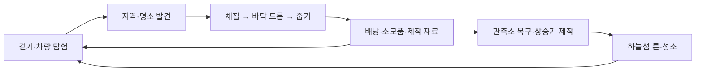
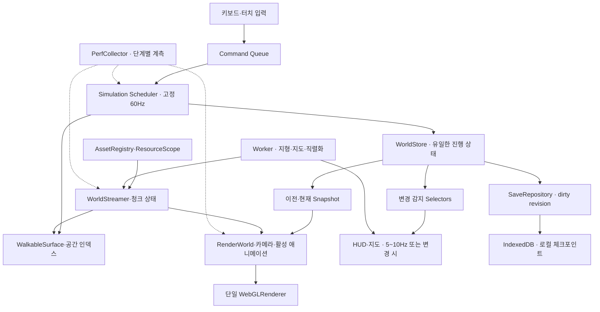
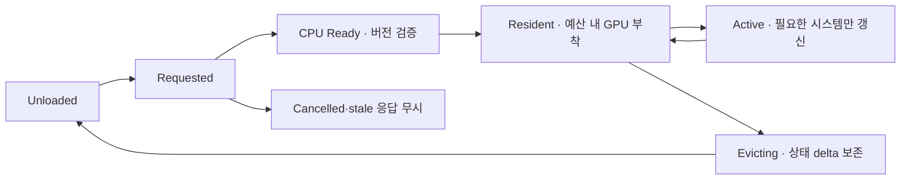
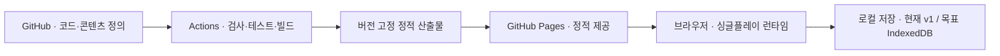
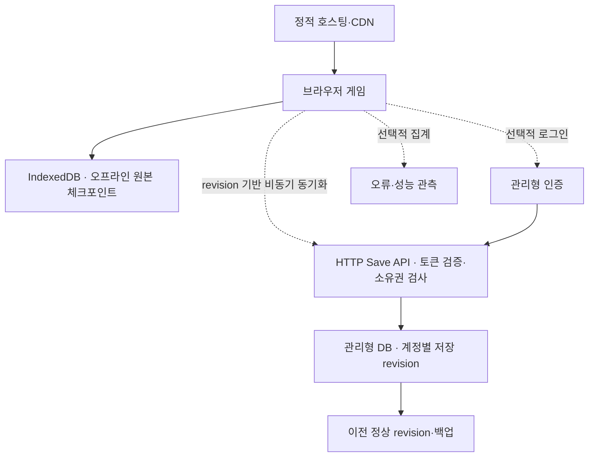

# Wild Atlas 게임 설계 및 인프라 아키텍처

- 작성: 2026-11-04
- 상태: 목표 구조 설계안. 성능 패널·실제 플레이 기준선·메뉴의 본 월드 갱신 중단·카메라 충돌 broadphase·고정 부품 병합과 그림자 정리를 구현했다. 청크·이동 충돌의 공간 조회·자원 소유권·저장 이행 등은 후속 단계다.
- 기준 코드: `1d17f4ac5fecf3aec130731ded121e6c71c3a8fe`
- 제품 방향: **싱글플레이 탐험 우선. 계정·클라우드 저장은 이후 단계.**
- 근거: [성능·자원 감사](./performance-audit.md), [측정 원본](./baseline-2026-11-04.json), [재현 도구](../../scripts/audit-game.ts)
- 후속 구현: [실제 브라우저 성능 패널·플레이 측정](./browser-performance-2026-11-04.md), [브라우저 측정 원본](./browser-performance-2026-11-04.json)
- 첫 최적화: [메뉴·미리보기의 본 월드 갱신 중단과 전후 비교](./menu-rendering-2026-11-04.md)
- 플레이 최적화: [카메라 충돌 후보 축소·관통 검증·전후 비교](./camera-collision-2026-11-04.md)
- 렌더 최적화: [그림자 비용 분리·고정 부품 병합·긴 프레임 추적](./shadow-rendering-2026-11-04.md)
- 후속 진단: [성능 패널 켬/끔 비교·GPU 샘플·지형 구역별 렌더링](./panel-stall-2026-11-06.md)
- Chrome 추적: [계단 장면의 실제 스레드 CPU 시간과 경과 시간 비교](./chrome-thread-trace-2026-11-06.md)

## 1. 결정 요약

현재 병목을 해결하는 첫 단계는 게임 서버 증설보다 **브라우저에서 실행할 작업과 보유할 자원을 제한하는 것**이다. 현재 배포는 정적 파일 제공이고 이동·충돌·애니메이션·렌더링은 브라우저가 처리한다. 네트워크 초기 로딩과 플레이 중 프레임 저하는 따로 측정한다.

Three.js와 TypeScript를 유지하고, 지금의 기능별 모듈을 살린다. 1명의 플레이어와 1대의 차량을 위해 엔진 교체나 전면 ECS 전환부터 시작하지 않는다. 먼저 측정 경계를 만들고, 공간 조회·자원 소유권·업데이트 주기를 분리한다.

핵심 결정은 다음과 같다.

| 항목 | 결정 | 이유 |
| --- | --- | --- |
| 플레이 권한 | 브라우저의 단일 `WorldStore`가 진행 상태 소유 | 오프라인 싱글플레이가 기본 |
| 실행 | 고정 시뮬레이션 + 별도 화면 갱신 | 화면 주사율에 따라 충돌 비용이 증가하는 것을 막음 |
| 월드 | 5개 지역은 콘텐츠 구분, 64m 청크는 작업·메모리 단위 | 지역 전체를 한 번에 생성·해제하지 않음 |
| 자원 | 공용 AssetRegistry + 소유자별 ResourceScope | 공유 자원을 중복 생성하거나 먼저 해제하는 문제 방지 |
| 지면 | 하나의 `WalkableSurface` 계약 | 화면·차량·발 접지·지도 높이 불일치 방지 |
| 저장 | 현재 v1 보존 → IndexedDB 기반 SaveRepository로 이행 | 저장 작업을 플레이 프레임에서 분리 |
| 배포 | 당분간 GitHub Actions → GitHub Pages 유지 | 현재 제품에는 상시 게임 서버가 필요하지 않음 |
| 이후 계정 | 인증 + HTTP 저장 API + 관리형 DB | 실시간 서버와 분리하여 추가 가능 |

여기서 제시하는 거리·프레임·메모리 값은 **초기 설계 예산**이다. 실제 브라우저와 모바일 측정으로 조정하며, 이미 달성한 수치로 해석하지 않는다.

## 2. 게임 설계

### 경험과 진행

작은 섬을 걸어 탐험하다가 자원을 얻고, 버기로 이동 범위를 넓히며, 관측소와 상승기를 복구하여 하늘 여정을 연다. 주요 경험은 길 찾기, 장소 발견, 채집, 이동의 자연스러움이다.

### 시스템별 규칙과 소유자

| 시스템 | 소유 상태 | 입력과 결과 | 반드시 지킬 규칙 |
| --- | --- | --- | --- |
| PlayerSystem | 위치·속도·스태미나·접지 | 이동·점프 → 이동 결과 | 계단과 착지의 접지 오차를 회귀 검사 |
| VehicleSystem | 위치·방향·속도·탑승 전환 | 가속·조향·제동·승하차 | 장애물·난간 관통 금지, 정차 후 승하차 |
| InteractionSystem | 현재 후보와 요청 | 상호작용 → 도메인 명령 | 화면에 안내한 대상과 실제 처리 대상 일치 |
| HarvestSystem | 타격 진행·완료 여부 | 타격 완료 → HarvestCompleted | 완료·보상은 한 번만 발생 |
| ItemSystem | 배낭 수량·드롭 상태 | 줍기·사용 → 수량 변경 | 줍기 중복 방지, 가득 찬 스태미나에 소모품 낭비 방지 |
| JourneySystem | 복구·룬·성소 진행 | 제작·활성화 → 진행 변경 | 제작 비용 차감과 결과를 하나의 상태 전이로 처리 |
| NavigationSystem | 목적지·도착 여부 | 지도 선택 → 안내·도착 이벤트 | 도착은 한 번 알리고 저장, 지역명 일관성 |
| RenderWorld | 장면 노드·애니메이션 캐시 | 읽기 전용 Snapshot → 화면 | 배낭·진행·보상 변경 권한 없음 |
| SaveRepository | 스냅샷·저장 상태 | dirty revision → 체크포인트 | 저장 실패가 새 게임 초기화로 이어지지 않음 |

입력은 `Command`, 결과는 명시적인 `DomainEvent`로 표현한다. 전역 이벤트 버스를 모든 상태의 대체재로 쓰지 않는다. `HarvestCompleted`, `ItemsPickedUp`, `StationRepaired`, `RegionArrived`처럼 시스템 경계를 넘는 사건만 큐에 넣고 한 틱 안에서 순서대로 처리한다. HUD와 효과는 결과를 읽는다.

새 콘텐츠는 우선 지역별 장소·수집품·제작법 데이터로 추가한다. 성능 예산과 자원 수명 기준을 통과하기 전에는 더 큰 월드, NPC 대량 추가, 실시간 멀티플레이를 확장 기준으로 삼지 않는다.

## 3. 현재 구조에서 확인한 문제

[감사 문서](./performance-audit.md)에 근거 코드와 측정 범위를 기록했다. 큰 문제는 다음 네 가지다.

1. `Game` 생성 시 지형·하늘섬·지역 구조물·캐릭터·차량을 전부 생성한다. 지도 베이스 이미지도 생성자에서 동기 계산한다.
2. 정지·메뉴·탑승으로 일부 대상이 보이지 않아도 월드 업데이트, 카메라 계산, 렌더 호출이 계속되는 경로가 있다. 캐릭터 미리보기는 별도의 WebGLRenderer와 RAF를 추가한다.
3. 도로 공간 인덱스는 있지만 차량 자원 충돌은 9개 지점마다 전체 자원 목록을 검사한다. 카메라도 정적 구조물 745개 후보를 두 번 조회하는 구조다.
4. `disposeScene`, 인스턴싱, 파편 풀은 이미 있다. 그러나 지역별 상주량 제한, 공유 자원의 소유권, 모든 종류의 GPU 자원 해제와 반복 사용 검증은 통일되어 있지 않다.

이것은 코드에서 확인한 구조적 비용이다. **사용자 기기의 낮은 FPS 원인이 어느 항목인지, GPU 메모리가 실제로 누수되는지는 아직 브라우저 측정이 필요하다.**

## 4. 목표 런타임 구조

### 의존성 경계

- `core/domain`: 브라우저 API와 Three.js에 의존하지 않는 규칙과 저장 가능한 데이터.
- `world`: 콘텐츠 ID, 지면 조회, 청크 데이터, 공간 조회. 장면 객체를 저장 데이터에 넣지 않는다.
- `render`: Three.js 객체와 애니메이션. 도메인 상태는 변경하지 않는다.
- `platform`: WebGL, Worker, 오디오, 입력, 저장소의 어댑터.
- `ui`: 명령을 보내고 선택된 상태를 표시한다. 월드 배열 전체를 직접 스캔하지 않는다.
- `app`: 생성 순서, 모드 전환, 스케줄러와 오류 복구만 조율한다.

현재 기능 폴더를 한꺼번에 옮기지 않는다. `Game`에서 scheduler, query, persistence, resource owner를 한 경계씩 추출한다. 순수 도메인에서 Three.js Vector를 없애는 변경은 벡터 최적화와 별개로 작게 진행한다.

### 프레임 처리

1. RAF에서 경과 시간을 accumulator에 더한다.
2. 시뮬레이션은 1/60초로 전진한다. 기존 계단·차량의 120Hz 내부 세분화는 회귀 검증 전까지 유지한다.
3. 한 RAF의 따라잡기는 최대 4틱으로 제한한다. 밀린 시간은 별도 지표로 기록하고 무한 루프를 피한다. 숨겨진 탭 복귀 시 accumulator와 이전 시간을 재설정한다.
4. 화면은 이전·현재 Snapshot을 보간한다. 지면·계단의 발 접지는 시각 보간으로 구조물을 뚫지 않도록 별도 제약을 유지한다.
5. HUD는 바뀐 값만 갱신한다. 미니맵의 정적 배경, 방문 셀, 동적 표식을 다른 레이어로 둔다.
6. save·지도 생성·청크 생성은 프레임 필수 작업에 포함하지 않는다.

| 실행 모드 | 시뮬레이션 | 화면 | 자원 작업 |
| --- | --- | --- | --- |
| 플레이 | 고정 틱 | 목표 60/30 FPS | 프레임 예산 안에서 준비된 청크 부착 |
| 설정·배낭·정지 지도 | 중지 | 처음 한 번, 이후 변경 시 | 필요한 UI 작업만 |
| 캐릭터 미리보기 | 월드 중지 | 미리보기 대상만 30 FPS부터 | 별도 전체 월드 렌더 금지 |
| 문서 숨김·포커스 상실 | 중지 | 명시적으로 RAF 중단 | 로컬 저장 요청, 오디오 일시 정지 |
| WebGL 문맥 손실 | 중지 | 복구 안내 | CPU 상태 보존, 자원 재부착 후 재개 |

초기에는 미리보기 renderer를 유지하되 기본 월드의 렌더를 중단한다. 이후 필요하면 같은 renderer의 별도 viewport/scissor로 통합한다. 브라우저가 배경 RAF를 제한하는 동작에만 의존하지 않는다.

## 5. 월드·지도·충돌 설계

### 지역과 청크

바람 초원·거울 호수·속삭이는 숲·구름 산맥·코랄 해안은 콘텐츠와 탐험의 의미 단위다. 메모리와 로딩은 더 작은 **64m 청크**로 관리한다. 하늘층은 같은 XZ 좌표라도 다른 `layerId`를 쓴다.

초기값:

- 충돌·상호작용 상세 영역: 현재 청크 중심의 3×3을 최소값으로 두고, 보행/차량 swept bounds와 카메라 target→eye 선분·여유 폭을 포함하는 청크의 합집합으로 확장한다.
- 차량은 2초 후 swept bounds를 더해 다음 청크를 먼저 요청한다. 빠른 이동에도 충돌 데이터가 그래픽보다 먼저 준비되어야 한다. 다음 충돌 데이터가 늦으면 준비된 경계 앞에서 감속하고 재시도 상태를 표시한다. 비어 있는 지형으로 통과시키거나 진행을 초기화하지 않는다.
- 화면용 지면·오브젝트: 주변 5×5를 출발점으로 하되, 원경은 별도의 저해상도 섬 실루엣으로 유지한다. 현재의 긴 시야를 갑자기 잘라내지 않는다.
- 렌더 부착 예산: 처음에는 프레임당 2ms 이내. 한 청크가 넘으면 작업을 나눠 여러 프레임에 부착한다.
- 해제 거리는 로드 거리보다 청크 하나 이상 크게 잡는다. 경계에서 계속 생성·해제되는 일을 막는다.

처음에는 앱당 장기 실행 Worker 하나를 공유하고 이동에 필요한 충돌 데이터 작업을 전체 지도 작업보다 먼저 처리한다. CPU Ready 결과 대기는 2개부터 제한한다. jobId·worldVersion·chunk revision으로 오래된 응답을 버리고, 큰 결과는 Transferable buffer로 넘긴다. 전송 후 분리되는 buffer를 다른 소유자가 계속 읽지 않게 한다. Worker 수와 대기열을 청크 수만큼 늘리지 않는다.

브리지·계단처럼 청크 경계를 가로지르는 구조물은 하나의 구조물 ID와 고유한 소유 청크를 가진다. 이웃 청크는 충돌 조회 참조를 가진다. 중복 생성·보상·해제를 막고, 청크 가장자리의 height sample은 같은 경계 데이터를 사용한다.

### 한 지면 계약

`WalkableSurface.sample(x,z,layer)`는 높이·노멀·표면 종류·구조물 ID를 반환한다. 차량, 보행, 발 IK, 지도와 시각 메시 빌더가 같은 계약을 사용한다.

- 연속적인 자연 지형·도로는 생성 결과를 청크 높이 캐시에 저장한다. 화면 메시와 샘플러가 같은 삼각형과 보간 규칙을 사용한다. 물리 틱마다 Worker 응답을 기다리지 않고 메인 스레드의 준비된 데이터를 조회한다.
- 다리, 상승기, 계단, 난간은 정확한 해석적 높이와 충돌 형상을 우선한다. 계단 경계를 낮은 해상도 heightmap으로 뭉개지 않는다.
- 원경 LOD는 화면만 단순화한다. 플레이어가 설 수 있는 영역의 충돌 정확도를 떨어뜨리지 않는다.
- 도로 교차부와 지상/하늘 전환은 현재 회귀 테스트를 유지한다. 접지 메시와 충돌 높이의 초기 허용 오차는 연속 지면 5cm, 계단·다리는 기존 테스트 정밀도를 따른다.

공간 인덱스는 기존 도로의 32m 인덱스를 확장하는 방향으로 시작한다. 자원·드롭·정적 충돌물마다 조회 API를 두고, AABB/거리의 broad phase 후에 정확한 검사를 한다. 카메라는 전체 장면 메시 대신 근처의 단순 충돌 프록시만 raycast한다. 복잡한 원경 메시가 정말 필요할 때만 BVH 도입을 평가한다.

## 6. 자원 소유권과 수명

`scene.remove()`는 GPU 자원 해제와 다른 작업이다. 재사용을 위해 남긴 캐시와 해제되지 않은 객체도 다른 상태다. Three.js의 명시적 dispose 요구를 공통 계약으로 만든다. [공식 cleanup 설명](https://threejs.org/manual/pages/cleanup.html), [자원별 dispose 설명](https://threejs.org/manual/pages/how-to-dispose-of-objects.html)

| 소유자 | 보유 자원 | 해제·재사용 규칙 |
| --- | --- | --- |
| AppScope | renderer, scheduler, 입력, 오디오, Worker | 앱 종료/HMR/초기화 실패 시 한 번 해제 |
| AssetRegistry | 공용 Geometry·Material·향후 Texture | key별 acquire/release, 참조 0이면 한도 내 LRU 또는 dispose |
| ChunkScope | 청크 노드·인스턴스 슬롯·충돌 등록 | 청크 eviction 시 등록 해제 후 공용 자원 참조 반환 |
| ActorScope | 리그 노드·독점 머티리얼·포즈 캐시 | 교체/비활성화 시 작업 중단, 마지막 소유자만 해제 |
| PreviewScope | 미리보기 장면·리스너·옵저버 | 닫기/실패 시 전부 해제. 기본 월드와 소유권 혼합 금지 |
| EffectsPool | 파편·드롭 화면 노드 | 고정/제한된 슬롯 재사용, 초과 시 시각 효과만 축소 |
| SaveRepository | JS 진행 데이터 | 청크 그래픽 해제와 무관하게 보존 |

공용 키의 예는 `box:1:1:1`, `stone:neutral`, `boot:body-slim:lod0`다. 단위 도형을 scale로 쓰고, 하늘 계단의 동일 재질·기둥·난간을 공용화/인스턴싱한다. 캐릭터 리그는 서로 달라도 도형은 공유할 수 있다. 애니메이션이 바꾸는 Material은 공유본을 직접 변경하지 않고 독점 인스턴스를 분리한다.

`ResourceScope.dispose()`는 여러 번 호출해도 안전해야 한다. RAF·이벤트·Observer·Worker 작업 취소, 장면 분리, 충돌 등록 해제, 독점 geometry/material/texture/render target, light shadow, 공용 자원 참조 반환을 모두 소유자가 처리한다. 카메라 프록시는 원본 geometry를 빌려 쓰므로 geometry를 dispose하지 않고 독점 material만 해제한다. 런타임 오류로 생성이 중단된 경우도 같은 경로를 사용한다.

앱 종료 순서는 새 입력·RAF 중단 → 정상 종료에서는 체크포인트 완료 확인 → Worker 작업 취소 → preview/actor/chunk scope 해제 → 남은 asset·shadow/target 해제 → renderer 해제다. 브라우저 강제 종료는 이 순서의 완료를 보장할 수 없어 이미 기록된 체크포인트로 복구한다. 파괴되는 미리보기 canvas의 context 종료와, 계속 재사용할 기본 renderer의 일시 정지를 구분한다.

초기 캐시 한도는 아래에서 출발해 실측으로 조정한다. 여기의 bytes는 geometry/instance buffer와 향후 decoded image의 **소유자가 계산한 CPU 용량**이며, JS heap 전체나 VRAM 값이 아니다.

| 한도 | 데스크톱 출발점 | 모바일 출발점 |
| --- | ---: | ---: |
| 앱 고정 자원 계산 용량 | 32 MiB | 24 MiB |
| 반환된 재사용 LRU 자원 계산 용량 | 32 MiB | 16 MiB |
| GPU에 붙은 상세 지상 청크 | 최대 25개부터 검증 | 최대 9~25개, 품질별 검증 |
| CPU Ready 부착 대기 청크 | 2개 | 2개 |
| 생성 Worker | 1개 | 1개 |

참조 중인 자원을 LRU가 해제해서는 안 된다. 선택적 효과·원경 자원은 한도에 도달하면 낮은 LOD로 대체하거나 새 부착을 미룬다. 필수 자원이 한도를 넘으면 품질·활성 범위를 낮추고 진단 지표에 남긴다. 단순히 캐시 한도를 없애는 대응은 하지 않는다.

현재 파편 풀과 자원 InstancedMesh는 유지한다. 전역 인스턴스 배치는 청크별 배치로 나눠 frustum culling과 상주량 제한을 적용한다. 배치를 나누면 draw call은 늘 수 있으므로 무조건 작게 쪼개지 않고 **화면 호출 수와 처리 인스턴스 수를 함께 측정**한다. [InstancedMesh 문서](https://threejs.org/docs/pages/InstancedMesh.html)

## 7. 콘텐츠 데이터와 저장

### 버전과 ID

서로 다른 네 가지 버전을 분리한다.

- `appBuildId`: 실행 코드 릴리스.
- `worldVersion` / `generatorVersion`: 월드 배치·생성 규칙과 안정적인 자원 ID.
- `assetManifestVersion`: 청크·도형·텍스처 등의 콘텐츠 묶음.
- `saveSchemaVersion`: 저장 데이터 표현.

현재 자원 ID는 생성 배열의 순서에 기반한다. 청크 생성으로 바꾸면서 로컬 배열 인덱스로 다시 부여하면 기존 채집 기록이 다른 나무에 붙는다. v1 월드는 기존 ID를 유지하는 호환 manifest를 고정한다. 이후 ID는 `worldVersion + layer + authored/generated entity key`로 만들고 렌더 인스턴스 슬롯과 분리한다.

정의 데이터에는 아이템, 지역, 제작법, 도로·다리, 구조물 ID를 둔다. 저장에는 위치, 차량, 배낭, 채집·복구·룬 delta, 목적지·도착 여부만 둔다. 재생성할 수 있는 Mesh·지도 이미지·전체 지형 정점은 저장하지 않는다.

### 로컬 저장 이행

지금의 v1 localStorage는 작은 기존 기록의 호환 입력으로 남긴다. 진행 저장은 `SaveRepository` 아래 IndexedDB로 옮기고 localStorage에는 작은 환경 설정만 남긴다. Web Storage가 동기식이라는 점을 고려한 선택이다. [Web Storage](https://developer.mozilla.org/en-US/docs/Web/API/Web_Storage_API), [IndexedDB](https://developer.mozilla.org/en-US/docs/Web/API/IndexedDB_API)

1. 상태 변경 시 revision을 증가시키고 dirty를 표시한다.
2. 임시 체크포인트는 단일 쓰기 큐로 합친다. 자동 저장은 10~30초 범위에서 debounce하고 주요 진행 사건 뒤에도 요청한다.
3. Worker로 순수 데이터 snapshot을 직렬화하거나 IndexedDB 쓰기를 위임한다. Three.js 객체를 Worker로 보내지 않는다.
4. 새 revision을 트랜잭션으로 기록하고 최근 정상 체크포인트를 보존한다. 실패하면 이전 정상 저장을 유지하고 사용자에게 재시도 상태를 보인다.
5. v1 → v2 이행은 원본을 먼저 보존하고 검증한 뒤 새 포맷으로 커밋한다. 잘못된 데이터는 새 탐험으로 조용히 덮어쓰지 않는다.
6. `pagehide`에 시작한 비동기 쓰기의 완료를 보장할 수 없으므로 평소 체크포인트를 기준으로 복구한다. 진행 내보내기/가져오기를 계정 도입 전에 제공한다.

## 8. 배포·인프라

### 지금 운영할 구조

GitHub Pages는 HTML/CSS/JavaScript를 제공하는 정적 호스팅이다. 현재 서버에서 게임 시뮬레이션을 돌리는 구조는 아니다. [GitHub Pages 설명](https://docs.github.com/en/pages/getting-started-with-github-pages/what-is-github-pages)

배포 파이프라인을 다음 순서로 보강한다.

1. 기존 format/lint/typecheck/318개 기능 회귀 테스트를 보존한다. 테스트 개수 자체를 성능 기준으로 삼지는 않는다.
2. headless 구조 감사, 번들 크기 비교, 저장 fixture 호환 검사를 추가한다.
3. 빌드된 preview를 대상으로 실제 브라우저 smoke test와 정해진 성능 경로를 실행한다. 브라우저·해상도·품질·기기를 고정한다.
4. `buildId`, 콘텐츠 해시, 호환 world/save 버전을 manifest에 넣는다. 코드와 청크를 한 릴리스로 묶는다.
5. 산출물 검증 후 Pages에 배포하고 새 세션에서 health smoke test를 한다. 저장을 지우는 배포 검증은 하지 않는다.
6. 이전 검증 산출물과 manifest를 보존해 되돌린다. 롤백할 앱이 현재 save schema를 지원하는지도 검사하며, 지원하지 않는 저장은 읽기 전용 복구 대상으로 보존한다. 이미 열린 탭은 자신이 시작한 manifest를 계속 사용한다. 예전 청크를 보존할 수 없는 호스팅에서는 버전 불일치를 감지해 체크포인트 저장 후 재시작을 안내한다.

정적 파일이 작고 현재 호스팅 요구를 만족하면 Pages를 유지한다. 향후 대형 콘텐츠와 cache header 제어, 미리보기 배포, 원자적 릴리스 전환이 필요해지면 **정적 Object Storage + CDN**으로 대체한다. 이 교체는 게임 도메인과 무관한 배포 어댑터 변경이어야 한다. Service Worker 오프라인 캐시는 오래된 코드·콘텐츠 혼합 위험을 해결한 뒤 추가한다.

### 계정·클라우드 저장이 필요해졌을 때

공급업체와 요금제는 이 단계의 운영 요구를 확인한 뒤 결정한다. 현재 계정 서버·상시 컨테이너·Kubernetes·실시간 매치 서버를 도입하는 계획은 포함하지 않는다.

클라우드 저장 계약:

- 로컬 플레이는 네트워크와 로그인 상태에 의존하지 않는다. Save API가 느려도 프레임을 막지 않는다.
- `GET /v1/saves/:slot`은 revision과 snapshot을 반환한다.
- `PUT /v1/saves/:slot`은 `If-Match: revision`, idempotency key, schema/world version을 검사한다.
- 같은 revision을 다른 기기에서 바꾸면 409/412 충돌로 알리고 두 기록을 보존한다. 타임스탬프가 늦은 기록으로 자동 덮어쓰지 않는다.
- API는 검증된 사용자 소유의 slot만 읽고 쓴다. 클라이언트에 DB 관리자 키를 넣지 않는다. 허용 Origin, payload 크기, 요청 빈도를 제한한다.
- 장비별 저장 크기·월간 동기화 수·백업 보존량으로 비용을 추정한다. 프레임마다 서버에 위치를 전송하지 않는다.
- 싱글플레이 저장은 사용자 진행의 복사본이다. 이후 경쟁/거래/공유 월드를 붙일 경우 서버 권한 모델을 별도 설계한다.

## 9. 성능 예산과 관측

다음은 초기 목표이며, 현재 브라우저 실측 결과가 아니다.

| 항목 | 데스크톱 기준 | 모바일 기준 |
| --- | --- | --- |
| 참조 환경 | M1 Pro, Chromium 계열, 1440×900, 중간 품질 | 중급 Android 실기기 지정 필요, 390×844 CSS px부터 |
| 목표 | 60 FPS, foreground frame p95 ≤ 16.7ms | 30 FPS, p95 ≤ 33.3ms |
| 긴 프레임 | p99 ≤ 33.3ms | p99 ≤ 50ms |
| 메인 스레드 활성 작업 예산 | p95 ≤ 8ms | p95 ≤ 16ms |
| GPU 예산 | p95 ≤ 8ms부터 검증 | p95 ≤ 16ms부터 검증 |
| 초기 DPR 상한 | 중간 1.25, 높음 1.5부터 | 1.0부터 |
| 화면 draw calls 검토선 | 기본 pass 350 이하부터 평가 | 기본 pass 180 이하부터 평가 |
| 실제 화면 삼각형 검토선 | 250k 이하부터 평가 | 120k 이하부터 평가 |
| 청크 부착 | 프레임당 2ms 이하 | 프레임당 1ms 이하부터 |
| 정지·배경 | 월드 반복 렌더 0, 변경 때만 갱신 | 동일 |

CPU와 GPU 시간은 파이프라인에서 겹칠 수 있으므로 단순 합으로 FPS를 계산하지 않는다. 실제 frame p95/p99를 최종 기준으로 삼는다. draw call·삼각형 수만으로 프레임 성능을 보장하지 않는다. DPR 1.7은 1.0 대비 픽셀 수가 약 2.89배이므로 해상도와 그림자 조절을 함께 평가한다.

수집 지표:

- network: transferred bytes, cache hit, 최초 로드 시간, 코드 파싱, 최초 조작 가능 시점.
- CPU: input/simulation/surface query/camera/animation/DOM/save/attach 단계 시간, long task와 GC 징후.
- GPU/scene: `renderer.info.render.calls/triangles`, `memory.geometries/textures`, 프로그램 수, shadow pass, 지원 기기의 GPU timer. `renderer.info`를 VRAM 사용량으로 해석하지 않는다. [WebGLRenderer 문서](https://threejs.org/docs/pages/WebGLRenderer.html)
- lifetime: owner별 geometry/material/texture/target 수, 활성 청크 수, cache bytes·참조 수·최종 사용 시각.
- game: dropped simulation time, 틱 횟수, 충돌 후보 수, 청크 요청 지연, stale/cancelled 작업 수.

계측은 개발 빌드나 명시적 진단 모드에서 시작한다. production 관측을 추가할 때는 build/품질/화면 크기/기기 등급과 집계 수치만 배치 전송하고 저장 내용·입력·계정 정보를 성능 로그에 넣지 않는다.

해상도·그림자·풀 밀도·원경 LOD는 예산 초과가 지속될 때 낮추고, 안정 구간이 충분히 길어진 뒤 한 단계씩 올린다. 충돌, 보상, 저장 정확도는 품질 등급에 따라 바꾸지 않는다.

## 10. 구현 순서와 완료 조건

| 단계 | 구현 범위 | 통과 조건 |
| --- | --- | --- |
| P0-A 계측 | 단계별 timer, renderer.info, 경로 재현, 현재 성능 trace | 실제 브라우저 기준선과 최초 병목을 설명 가능 |
| P0-B 불필요 작업 | 정지/숨김/미리보기 render 스케줄, 숨겨진 actor animation 중단 | 메뉴 30초 동안 월드 반복 render 0, 입력 복귀 정상 |
| P1-A 자원 소유권 | AssetRegistry/ResourceScope, SkyView 재질·기둥·계단 공유, shadow/proxy 정리 | 미리보기·외형 변경·재시작 20회 후 자원 수 증가가 누적되지 않음 |
| P1-B 공간 조회 | 자원·드롭·카메라 broad phase, surface cache, 임시 벡터 재사용 | 차량·카메라 단계 p95 감소, 기존 접지·승하차 회귀 통과 |
| P2 청크·Worker | 지형/지도 생성 비동기화, 주변 상주, 낮은 LOD 원경 | 30회 지역 왕복 후 상주량 한도 유지, 첫 조작 전에 전체 지도를 기다리지 않음 |
| P3 저장 | IndexedDB, v1 이행, 정상 체크포인트와 내보내기 | 저장 실패·강제 종료·손상 데이터에서 기존 진행 복구 |
| P4 클라우드 | 사용자가 계정 기능을 원할 때 인증·Save API | 오프라인 플레이, 기기 간 충돌 보존, 복구 검증 |

P0와 P1의 측정 결과를 보고 청크 크기·LOD 범위를 확정한다. 수치를 확인하기 전에 수주 분량의 엔진 재작성부터 착수하지 않는다. 다음 기능 추가의 첫 통과 기준은 **브라우저 프레임 기준선과 소유자별 자원 수명이 설명되는 상태**다.

### 수락 시나리오

동일 viewport·DPR·품질에서 cold/warm 세션을 분리하여 기록한다.

1. 캠프에서 30초 서기 → 도로 주행 → 호수 다리 왕복 → 급회전·후진·승하차.
2. 계단 오르내리기·정지·재시작 → 점프·착지 즉시 달리기 → 상승기 양방향 → 하늘 룬.
3. 지도·배낭·캐릭터 미리보기 열고 닫기 20회, 외형 변경 20회.
4. 다섯 지역 왕복 30회와 지상/하늘 전환. GC 이후 heap와 자원 개수가 warm baseline 주변에서 평탄해지는지 확인.
5. 정지 메뉴 30초, 탭 숨김 30초, 복귀, viewport 변경, WebGL 문맥 손실·복구.
6. 저장 중 종료·저장소 거부·손상 저장·v1 fixture·이전 릴리스 실행. 사용자의 실제 저장 대신 별도 테스트 프로필을 사용.

GPU 자원 수가 0이 되는지를 성공 기준으로 삼지 않는다. renderer 내부 재사용 자원은 남을 수 있으므로 동일 시나리오를 반복했을 때의 **증가 기울기와 소유자 한도**를 검증한다.

## 11. 참고 자료

제안의 API 가능 여부는 설치된 Three.js r180 소스와 다음 공식 문서로 확인했다. 최신 문서와 설치 버전이 다르면 설치 버전 및 해당 버전 타입/소스를 우선한다.

- [Three.js: Cleanup](https://threejs.org/manual/pages/cleanup.html)
- [Three.js: How to dispose of Objects](https://threejs.org/manual/pages/how-to-dispose-of-objects.html)
- [Three.js: LightShadow](https://threejs.org/docs/pages/LightShadow.html)
- [Three.js: InstancedMesh](https://threejs.org/docs/pages/InstancedMesh.html)
- [MDN: WebGL best practices](https://developer.mozilla.org/en-US/docs/Web/API/WebGL_API/WebGL_best_practices)
- [MDN: Using Web Workers](https://developer.mozilla.org/en-US/docs/Web/API/Web_Workers_API/Using_web_workers)
- [MDN: Web Storage](https://developer.mozilla.org/en-US/docs/Web/API/Web_Storage_API)
- [MDN: IndexedDB](https://developer.mozilla.org/en-US/docs/Web/API/IndexedDB_API)
- [GitHub: About Pages](https://docs.github.com/en/pages/getting-started-with-github-pages/what-is-github-pages)
