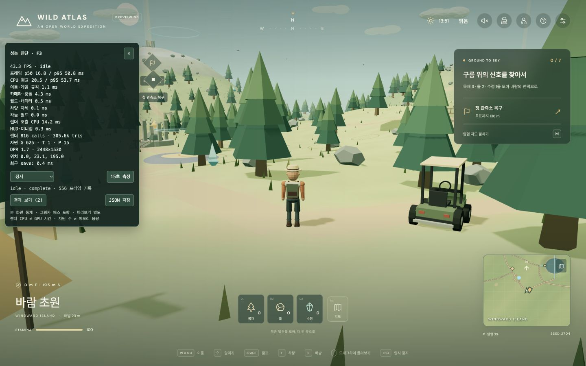

# 실제 브라우저 플레이 성능 — 2026-11-04

성능 패널을 추가하고 **로컬 production 빌드를 Chrome에서 실제 키 입력으로 조작**했다. 배포 사이트를 갱신하거나 게임 최적화를 적용한 결과는 아니다.

이 문서는 첫 계측 당시의 기준선이다. 이후 [메뉴·미리보기의 본 월드 갱신 중단](./menu-rendering-2026-11-04.md)을 구현하고 동일 조건에서 새로 비교했다. 현재 패널은 schema 2의 실제 world/preview activity 카운터를 함께 제공한다.

- [측정 원본 JSON](./browser-performance-2026-11-04.json): 브라우저 패널의 `JSON 저장`으로 내려받은 12개 기록, 모두 15초 완료, 누락 샘플 0.
- [이전 headless 감사](./performance-audit.md), [목표 아키텍처](./README.md).
- 측정한 앱 JS: `index-Cg_wSMi4.js`, SHA-256 `4d0f24576b49110f1c05b18426eacfece39096ed5332383bd84c51b4d68e352c`.
- 기준 커밋 `1d17f4ac5fecf3aec130731ded121e6c71c3a8fe` + 이번 성능 계측 코드. 측정 뒤 패널을 왼쪽으로 옮기고 도움말·입력 처리를 보완했다. 최종 산출물 해시는 달라진다.

## 사용법

```sh
bun run build
bun run preview --port 4173
# http://127.0.0.1:4173/?perf=1
```

게임에서 **F3**로 패널을 켜고 끈다. 키보드에서 F3가 운영체제 기능에 배정되어 있으면 URL의 `?perf=1`을 사용한다. 시나리오를 고른 뒤 `15초 측정`을 누르면 3초 준비 후 15초 동안 기록한다. 모달에서도 사용할 수 있다. `결과 보기`는 JSON을 표시하고, `JSON 저장`은 로컬 파일을 내려받는다. 기록은 탭 메모리에만 보관되며 새로고침하면 사라진다. 네트워크로 전송하지 않는다.

- 최근 5초의 FPS, 프레임 p50·p95, CPU 평균·p95를 표시한다.
- 이동·게임 규칙 / 카메라·충돌 / 월드·캐릭터 / 차량 자세 / 하늘 / 렌더 호출 / HUD로 CPU 구간을 나눈다.
- 원본에는 p99·최대값, 33.34ms·50ms 초과 프레임 수, 실제 모드별 프레임 수, 시작·종료 위치, 자원 수 범위도 남는다.
- `save`, `map.draw`, `panel.*` 동기 작업을 별도 기록한다. 프레임 구간과 중복될 수 있으므로 합산하지 않는다.
- 패널 갱신은 초당 2회. 패널을 끄면 시간 수집·샘플 생성·패널 DOM 갱신을 하지 않는다.
- 최근 프레임 600개, 측정당 4096개, 측정당 이벤트 300개, 최근 이벤트 30개, 결과 12개로 저장량을 제한한다. 초과 샘플은 `droppedSamples`로 표시한다.
- 탭이 실제로 숨겨지거나 패널을 끄면 진행 중 기록을 중단 상태로 보관하고 프레임 간격을 초기화한다. 이번 자동화의 별도 빈 탭 생성은 게임 탭을 숨기지 않았으므로 숨김 경로의 브라우저 검증으로 계산하지 않는다.

## 조건과 해석 범위

- Apple M1 Pro / macOS arm64. Chrome UA 버전 `156.0.0.0`. 기기 정보는 이전 로컬 감사와 같은 호스트이며 UA의 `Intel Mac` 문자열로 CPU 종류를 추정하지 않았다.
- 주소 `http://127.0.0.1:4173/?perf=1`. 새 로컬 저장으로 시작, 시드 2704, 기본 캐릭터. 기존 배포 사이트의 사용자 저장은 건드리지 않았다.
- viewport 1440×900으로 고정. 기본 구간은 render DPR 1.7, drawing buffer 2448×1530, 그림자 켬이다.
- 브라우저 viewport override가 `devicePixelRatio`를 1로 노출한다. 최초 renderer 설정은 override 이전의 DPR을 사용했으며, 품질을 다시 설정한 이후에는 DPR 1이 적용되었다. **실제 렌더 DPR·그림자 상태를 각 기록에서 확인해야 한다.** 9~12번은 그림자가 켜져 있어도 DPR 1이다.
- 처음 표시된 로딩·셰이더 컴파일 직후 값은 기준선에서 제외했다. 각 기록은 3초 준비 뒤 15초지만, 반복 실험의 통계적 신뢰구간을 확보한 실험은 아니다. 브라우저 자동화·다른 프로세스·발열·GC는 완전히 통제하지 않았다. 차이는 이 세션의 관측값이다.
- **FPS는 RAF 간격**에서 계산하며 디스플레이에 실제 표시된 프레임 수를 측정한 것은 아니다. 게임의 최대 dt 45ms 제한과 무관하게 긴 RAF 간격을 원본에 남긴다.
- CPU 시간은 `performance.now()`로 잰 해당 JS 호출의 경과 시간이다. GPU 대기·브라우저 스케줄링 영향이 섞일 수 있으며, JS 실행 시간만 분리한 CPU profiler trace가 아니다.
- 렌더 CPU는 `renderer.render()`의 반환까지다. **GPU 실행 시간, layout/paint, 미리보기의 별도 RAF 작업, 패널 자체 갱신 시간은 CPU 구간에 포함하지 않는다.** 이 작업의 영향은 RAF 간격에는 반영될 수 있다.
- calls·triangles는 본 화면 renderer의 그림자 패스를 포함한다. `info.autoReset=false`와 프레임 시작 `info.reset()`으로 Three.js의 그림자 뒤 자동 초기화에 의한 누락을 방지했다. 별도 캐릭터 미리보기 renderer 통계는 합산하지 않는다.
- geometry·texture·program 수는 본 화면 renderer가 보유하는 객체 수다. **JS heap/VRAM의 바이트 수나 누수 판정이 아니다.** 새 시야의 geometry가 처음 업로드되면서 증가할 수도 있다.
- 네트워크·초기 월드 생성·초기 512² 지도 생성·실제 GPU timer·장시간 heap snapshot은 이번 패널의 측정 범위 밖이다.

## 기본 플레이 결과

모두 DPR 1.7, 그림자 켬. CPU·프레임 값은 ms, calls는 프레임당 평균이다. 정지·걷기와 계단·지도는 카메라 위치가 달라 직접적인 기능별 인과 비교가 아니다.

| JSON 기록 | 조작 | 평균 FPS | 프레임 p95 | 전체 CPU 평균 | 렌더 CPU 평균 | 카메라 CPU 평균 | calls 평균 |
| --- | --- | ---: | ---: | ---: | ---: | ---: | ---: |
| 1 | 캠프에서 정지 | 48.5 | 41.5 | 18.28 | 12.50 | 3.85 | 817.5 |
| 2 | 캠프에서 북쪽으로 W 보행 | 46.9 | 41.7 | 18.88 | 12.07 | 4.63 | 780.7 |
| 3 | 바람의 언덕 계단 W/S 왕복·반전 | 45.6 | 50.1 | 19.13 | 11.20 | 6.18 | 606.3 |
| 4 | 같은 계단 상단에서 설정 일시정지 | 55.0 | 41.6 | 15.92 | 9.81 | 5.44 | 611.0 |
| 5 | 같은 위치에서 전체 지도 유지 | 51.8 | 49.5 | 16.62 | 9.94 | 5.86 | 611.0 |
| 6 | 버기 가속·양방향 조향·제동·후진 | 45.2 | 50.0 | 19.67 | 12.14 | 4.38 | 858.5 |

걷기는 기록 구간에서 약 66m 전진했다. 계단은 입구 `(-65, 94)` 부근에서 W/S를 번갈아 눌러 실제 단을 왕복했고, 마지막 화면은 상단에 선 상태다. 차량은 캠프에서 F로 타고 W+D / W / W+A / W / Space / S / Space 순으로 조작했다. 차량 기록의 시작·끝 위치가 가까운 이유는 후진해서 돌아왔기 때문이며, 전체 도로·다리 노선을 완주한 벤치마크로 해석하지 않는다.

**가장 명확한 낭비는 일시정지 중 작업이다.** 설정에서는 이동 규칙이 거의 0ms가 되지만 카메라 5.44ms, 렌더 9.81ms와 611 calls가 계속 발생한다. 지도도 같은 경향이다. CPU 전체에서 두 구간이 차지하는 비중이 크므로 정적 메뉴에서 월드 갱신을 중단하는 작업을 첫 최적화로 선택한다.

차량의 이동·게임 규칙 구간은 평균 2.09ms로 보행 1.16ms보다 크지만 경로가 달라 증분 전체를 차량 충돌만의 비용으로 단정하지 않는다. 차량 주행에서도 렌더 호출이 가장 큰 구간이다.

## 같은 위치의 품질 비교

기록 7·8은 위치 `(0, 23.1, 195)`, 같은 카메라와 게임 시각 고정 상태다. 바람 등의 애니메이션은 계속된다. 품질 전환 직후 3초 준비를 거쳤다.

| 기록 | 설정 | 평균 FPS | 프레임 p95 | 렌더 CPU 평균 | 카메라 CPU 평균 | calls 평균 | triangles 평균 |
| --- | --- | ---: | ---: | ---: | ---: | ---: | ---: |
| 7 | 그림자 켬 · DPR 1.7 | 46.8 | 58.4 | 12.17 | 4.72 | 789.0 | 304,676 |
| 8 | 그림자 끔 · DPR 1.0 | 51.6 | 58.3 | 9.88 | 4.70 | 568.2 | 248,146 |

calls는 약 28%, 렌더 CPU 경과 시간은 약 19% 줄었지만 프레임 p95는 거의 같았다. 이는 **픽셀 수·그림자만 줄여서 모든 지연이 해결된다고 볼 수 없다는 근거**다. 두 설정을 동시에 바꿨으므로 해상도와 그림자 각각의 기여나 GPU 병목을 분리한 실험은 아니다. 다음 단계에서는 카메라 충돌 broadphase 개선 전후도 같은 위치에서 비교한다.

## 지도 조작·저장·미리보기·자원 수

- 기록 11: 정지 후 M으로 지도를 열고 거울 호수를 선택하고 확대·축소했다. `panel.map` 동기 호출 37.4ms, `map.draw` 3.3/3.0/8.7ms가 기록됐다. 패널 열기에는 지도 그리기·UI 생성이 중첩된다. 초기 지도 바탕 생성 시간과 혼동하지 않는다.
- 자동 저장 동기 호출은 이번 기록에서 약 0.1~0.4ms였다. 현재 작은 저장 데이터에서 렌더·카메라보다 우선적인 병목이라는 증거는 없다. 대용량 배낭·월드 변경 저장은 별도 검증이 필요하다.
- 기록 9: 캐릭터 달리기 미리보기 평균 32.0 FPS, 프레임 p95 66.8ms. 본 월드가 뒤에서 계속 렌더되는 상태이며 별도 renderer의 작업도 함께 실행된다. DPR 1이므로 기본 표와 동일 조건은 아니다. CPU 구간 합계만으로 미리보기 자체 시간을 추정하지 않는다.
- 미리보기 취소 10회 + 의상 변경 적용 10회(숲길/노을 교대, 마지막 노을 복원)를 실제 UI로 반복했다. F3를 꺼서 HUD 캐릭터 버튼을 가리지 않도록 했으며, 반복 후 다시 켰다. 이 동작 중 본 화면 자원이 **G914/T1/P28 → G779/T1/P27**로 줄었다. 외형 교체 시 기존 rig 자원이 해제되는 영향과 시야 업로드 차이를 포함할 수 있다.
- 반복 후 기록 10의 15초 동안 G779/T1/P27이 일정했다. **이 조건의 본 화면 객체 수가 계속 증가한다는 현상은 관찰하지 못했다.** 별도 preview context·GPU driver cache·heap 누수까지 검증한 것은 아니며 30회 지역 왕복도 아직 수행하지 않았다.
- 기록 12는 지도 유지 반복이다. 별도 빈 탭 생성으로 숨김 중단을 확인하려 했으나 게임 기록이 계속되어 `complete`로 끝났다. 이를 `interrupted-hidden` 검증 성공으로 보고하지 않는다.

## 다음 구현 순서와 완료 조건

1. **메뉴·미리보기에서 불필요한 본 월드 프레임 중단.** 최초/변경 시 한 번 그린 뒤 정적 메뉴에서 calls가 누적되지 않아야 한다. 패널 측정을 위해 RAF를 계속 돌리는 식으로 되돌리지 않는다. 모달 입력·복귀 dt·카메라·미리보기는 정상 동작해야 한다.
2. **카메라 충돌 후보 축소.** 기존 745개 proxy를 전부 변환·조회하는 경로에 공간 broadphase를 적용하고, 실제 계단·벽·다리·상승기 관통 회귀를 확인한다. 주행 중 규칙 계산은 카메라와 별도로 비교한다.
3. **렌더 호출·공유 geometry/material 정리.** shadow 포함 통계와 기본 패스 예산을 혼용하지 않고, 같은 시점에서 calls·프레임 p95·자원 수를 비교한다.
4. 청크/Worker·IndexedDB 이행은 위 결과를 확보한 뒤 진행한다.

최초 개선 목표는 “FPS 숫자 증가” 하나가 아니라 **정지 메뉴의 지속적인 월드 작업 제거 + 플레이 프레임 p95 개선 + 정상 이동·복귀 유지**다. 이번 변경에서는 성능 계측과 패널 배치·입력만 바꾸었으며, 이 최적화들은 아직 적용하지 않았다.

## 구현 근거와 검증

[Three.js WebGLRenderer info](https://threejs.org/docs/pages/WebGLRenderer.html)의 프레임별 통계와 [MDN performance.now](https://developer.mozilla.org/en-US/docs/Web/API/Performance/now)의 단조 증가 시간으로 측정한다. 설치된 Three.js r180 소스의 그림자 렌더 뒤 `autoReset` 위치도 확인했다.

- `bun run test`: 18개 파일, 323개 테스트 통과. 추가 테스트는 FPS 집계, 백분위, 긴 프레임 보존, 자원 수 범위, bounded history를 검증한다.
- `bun run check`, `bun run build` 통과. 기존 Three.js vendor 500kB 경고는 남아 있다.
- 실제 브라우저에서 F3 토글, 모달 내 패널, 15초 완료, 결과 보기, JSON 내려받기, 걷기·계단·차량·지도·외형 반복을 확인했다.
- 최종 빌드에서 수동 중지(준비 중 0프레임도 정상 처리), 결과 textarea에서 M을 눌러도 지도가 열리지 않는 동작, 이동한 패널이 HUD 캐릭터 버튼을 가리지 않는 동작을 재확인했다. 해당 탭의 console error는 0건이었다.



이미지는 최종 빌드 UI 확인용 최근 5초 통계다. 위 표는 별도 JSON의 15초 기록 평균이며 이미지의 순간 구간과 수치가 다를 수 있다.
