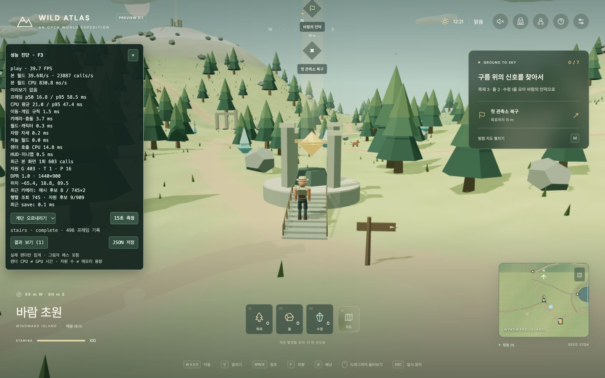
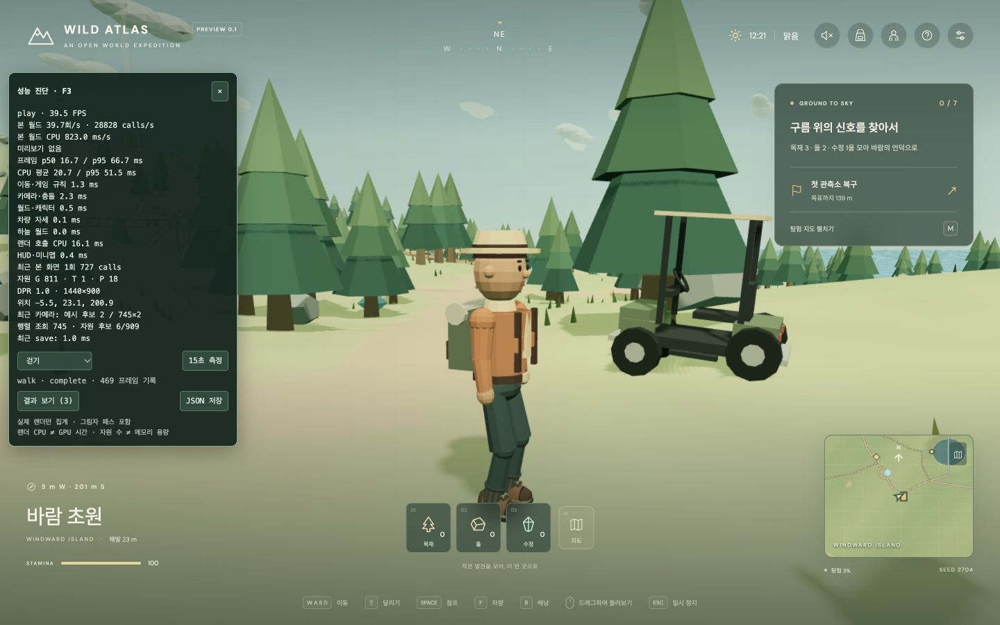
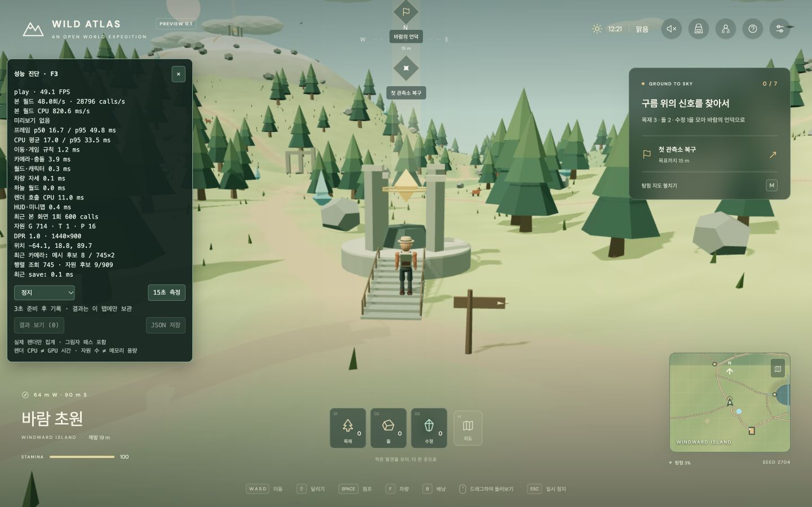

# 카메라 충돌 조회 최적화와 관통 회귀 검증 — 2026-11-04

카메라가 검사할 메시·자원을 공간 구획으로 좁혔다. **정밀 판정은 기존 양면 삼각형과 지형·수목 규칙을 유지**하고, 부드러운 카메라 이동 뒤의 안전 보정도 유지했다. 테스트한 계단·벽·상승기에서는 새 관통을 발견하지 못했다. 모든 지형·시점의 무결함을 보장하는 결과는 아니다.

## 실제 플레이 전후

Chrome에서 로컬 production 빌드를 직접 조작했다. viewport와 drawing buffer 1440×900, 렌더 DPR 1.0, 그림자 켬, 게임 시각 12:21 고정, 기본 카메라 yaw 0.06 / pitch 0.18 / zoom 38이다. 각 기록은 3초 준비 뒤 약 15초다.

| 조건 | 카메라 평균 ms 전→후 | 카메라 p95 ms 전→후 | 전체 FPS 전→후 | 전체 프레임 p95 ms 전→후 |
| --- | ---: | ---: | ---: | ---: |
| 캠프 정지 | 5.00 → **2.60** | 11.40 → 7.70 | 29.75 → 33.32 | 83.10 → 67.20 |
| 계단 중간 정지 | 6.22 → **4.61** | 14.60 → 12.70 | 35.02 → 33.10 | 66.70 → 66.70 |
| 북쪽 보행 | 6.45 → **2.96** | 16.60 → 7.10 | 27.06 → 31.30 | 100.10 → 74.90 |

캠프와 계단의 저장된 시작·종료 위치는 전후 정확히 일치한다. 계단은 `(-65.4468922408, 18.7502255379, 89.5204080536)`이다. 보행은 캠프에서 같은 W 입력을 19초 유지했지만, 긴 프레임에서 기존 dt 제한이 작동해 실제 기록 경로·이동 거리는 약간 다르다. 따라서 보행 결과는 같은 입력의 참고 비교이며, 고정 위치 비교와 같은 정밀도로 해석하지 않는다.

카메라 경과 시간은 세 조건에서 감소했지만 **전체 FPS가 모두 좋아진 것은 아니다.** 계단 FPS는 약 5.5% 낮아졌고 프레임 p95는 동일했다. 렌더 호출 경과 시간·다른 프로세스·GC·드라이버 대기 등은 완전히 통제하지 못했다. 카메라 최적화로 60 FPS를 달성했다거나 계단의 전체 프레임 성능까지 개선했다고 보고하지 않는다.

원본:

- [브라우저 개선 전](./camera-before-2026-11-04.json), [브라우저 개선 후](./camera-after-2026-11-04.json)
- [조건·빌드 식별·전후 비교](./camera-comparison-2026-11-04.json)
- [결정적 CPU 비교 원본](./camera-cpu-comparison-2026-11-04.json)

## 조회량

하나의 카메라 갱신에는 목표 위치 검사와 smoothing 이후 실제 위치 검사, 두 번의 조회가 있다.

| 한 갱신당 작업 | 개선 전 | 개선 후 |
| --- | ---: | ---: |
| 등록된 메시 | 745 | 745 |
| 계단의 메시 raycast 후보 합계 | 1,490 | **8** |
| 캠프의 메시 raycast 후보 합계 | 1,490 | **0** |
| 등록 메시 행렬 동기화 방문 | 1,490 | **745** |
| 계단·캠프 자원 후보 | 909 | **9** |

후보 수는 정밀 mesh raycast에 전달된 객체 수다. Three.js의 기존 raycast도 내부 bounding sphere 등으로 빠르게 거절하므로 “삼각형 계산 99.5% 감소”나 같은 비율의 CPU 절감으로 환산하지 않는다. 캠프의 메시 후보가 0이어도 자원과 지형 검사는 그대로 실행한다.

계층 행렬은 여전히 등록된 월드를 한 번 순회한다. **전체 월드를 전혀 방문하지 않는 구현은 아니다.** 이전처럼 각 leaf의 부모까지 두 번 반복 갱신하는 비용을 줄이고, 두 조회가 한 번 동기화한 결과를 공유한다. 더 큰 월드는 청크 수명과 연결하는 후속 작업이 필요하다.

## 결정적 CPU 비교

브라우저 측정과 별도로 동일 WorldScene·위치·yaw·dt를 사용해 구버전과 새 버전을 같은 프로세스에서 번갈아 실행했다. 케이스마다 120프레임 준비 + 600프레임을 측정했고, 두 실제 카메라 위치의 최대 오차는 **모든 케이스에서 0**이었다.

| 케이스 | 이전 평균 ms | 개선 평균 ms |
| --- | ---: | ---: |
| 캠프 | 0.3299 | 0.1379 |
| 계단 이동·급회전 | 0.4768 | 0.2736 |
| 풍차 벽 주변 | 0.3766 | 0.1889 |
| 다리 | 0.4547 | 0.2899 |
| 움직이는 상승기 | 0.4445 | 0.2474 |

이 실험은 Bun 1.3.14 / Apple M1 Pro / macOS arm64의 **CPU 전용 비교**다. WebGL 렌더러·HUD·실제 FPS·GPU 시간·사용자 저장은 포함하지 않는다. 실제 브라우저 표와 ms 절댓값을 직접 비교하지 않는다.

```sh
bun run benchmark:camera
```

이전 구현은 [테스트용 동결 reference](../../tests/helpers/legacy-camera-controller.ts)와 [전체 mesh traversal reference](../../tests/helpers/legacy-mesh-camera-collision.ts)에 보관했다. production 앱에서는 import하지 않는다. 측정은 [scripts/benchmark-camera.ts](../../scripts/benchmark-camera.ts)로 재현할 수 있다.

## 구현과 정확성 경계

- [SpatialGrid](../../src/game/shared/spatial-grid.ts): 32m XZ 구획, 중복 후보 제거. 긴 다리·큰 구조물은 모든 겹치는 cell에 등록한다. 너무 큰 객체는 overflow 목록, 너무 긴 조회는 전체 후보 fallback을 사용해 누락을 방지한다.
- [MeshCameraCollision](../../src/game/player/mesh-camera-collision.ts): geometry의 local AABB를 world AABB로 변환해 보관한다. 유한 시선 구간의 AABB·ray/AABB 검사를 통과한 대상에만 원래 양면 삼각형 raycast를 수행한다. 최근접 충돌과 기존 padding으로 카메라 거리를 계산한다.
- 움직이는 부모·회전·비균일 scale·상승기 위치는 매 갱신 자동 반영한다. geometry 교체와 position buffer version 변경도 bounds/sphere를 갱신한다. 숨겨진 부모나 분리된 자식은 후보에서 제외한다. 노드 추가·구조 변경 및 처음 투명했다가 불투명해진 메시의 새 등록에는 `rebuild()`가 필요하다. 현재 게임의 해당 장애물 구조는 초기 생성 후 고정이다.
- [ResourceCameraIndex](../../src/game/player/resource-camera-index.ts): 고정 위치·scale의 자원을 한 번 등록한다. 최대 반경의 2배로 조회 영역을 보수적으로 확장해 기존 알고리즘이 카메라 끝 너머에서 고려하는 자원까지 보존한다. 채집된 id는 기존 규칙에서 계속 제외한다. 자원 위치·scale을 바꾸는 미래 기능에서는 index를 재생성해야 한다.
- [CameraController](../../src/game/player/camera-controller.ts): 한 갱신의 두 ray가 변환·공간 index를 공유한다. target/direction/hit buffer를 재사용한다. smoothing 뒤 실제 카메라를 다시 검사하는 보정, FOV별 padding, 지형 20단계 검사, zoom·회전·추종 규칙은 유지했다.
- `dispose()`는 index·proxy 참조·전용 material을 해제한다. 렌더링 월드가 소유한 geometry는 해제하지 않는다. Game 종료에도 camera 정리를 연결했다. 동적 청크가 붙고 떨어지는 수명 연결은 이번 범위 밖이다.
- 성능 패널에 등록 수·조회 수·행렬 방문·mesh/resource 후보를 추가했다. 실제 카메라가 실행되지 않은 메뉴의 render-only 프레임에는 오래된 query 통계를 새 계산처럼 기록하지 않는다.

이는 rigid Mesh 기반 현재 장애물용이다. 새 instanced/skinned 장애물을 넣을 경우 그 형태에 맞는 proxy·bounds 처리가 필요하다. 원래 구현도 일반 Mesh proxy를 사용했다. 이번에 별도의 충돌 모양 단순화나 해상도·그림자·시야 거리 축소는 하지 않았다.

## 관통 검증

[camera-broadphase.test.ts](../../tests/camera-broadphase.test.ts)에서 다음을 검증했다.

- 실제 관측소 계단·기둥·명소 벽·다리·상승장 내부에서 yaw 16방향 × pitch 3개 × zoom 3개의 **2,016개 시선**이 기존 전체 삼각형 검사와 일치했다.
- 상승·하강하는 상승기를 121지점씩, 한 프레임 두 방향으로 조회했다. 회전하는 구조물·풍차와 이동하는 부모의 bounds가 갱신되며 기존 결과와 일치했다.
- 계단을 움직이고 급회전하는 360프레임에서 smoothing 이후 실제 카메라 위치가 기존 구현과 일치했다. 독립된 전체 삼각형 검사에서도 플레이어 target과 실제 카메라 사이 관통이 없었다.
- 600개 자원·지형 시선에서 전체 909개 자원 검사와 결과가 일치했다. 높은 고도·채집된 자원을 포함했다.
- 얇은 벽·안쪽에서 시작한 시선·cell 경계·부모 회전/scale·geometry 교체/버퍼 이동·거대한 구조물·숨김/제거/재등록·공유 geometry 보존을 검증했다.
- 기존 상승기 내부 벽과 smoothing 회귀 테스트도 통과했다.

실제 Chrome에서도 계단 중간에 멈춘 뒤 약 한 바퀴 회전해 정면·측면·반대편을 확인했다. 최종 빌드에서 계단 입구→상부→하부→중간 정지로 W/S를 조작했고 구조물 관통을 발견하지 못했다. 캠프 텐트 벽 옆에서는 낮은 시점과 가까운/먼 줌을 바꾸며 카메라가 벽 앞쪽으로 당겨지는 것을 확인했다. 이는 확인한 시점의 결과이며 모든 시선 또는 near-plane 모서리 전체를 수학적으로 보장하는 검증은 아니다.







이미지는 최근 약 5초 통계이며 위 표의 15초 평균과 다를 수 있다. 같은 사진만으로 성능 또는 모든 관통의 부재를 판정하지 않는다.

## 검증 상태와 재현 조건

정적 검사·타입 검사·production 빌드·전체 **21개 파일 339개 테스트**를 통과했다. 최종 브라우저의 모듈 경로도 `index-LXxHJE1y.js`로 확인했고 console error는 0건이었다. 검증 후 시각 흐름은 1배, viewport override는 기본값으로 복원했다. 기존 Three.js vendor 500kB 경고는 남아 있다.

브라우저 개선 전 앱은 `index-C4nJf_Kz.js`, 측정한 개선 후 앱은 `index-DS5aa5C6.js`다. 마지막에 메뉴 render-only 프레임의 계측 표시만 보완한 최종 앱은 `index-LXxHJE1y.js`이며 카메라 알고리즘은 동일하다. 이전 빌드는 `/private/tmp/wild-atlas-camera-before-20261104`에 임시 보관했다. 정량 비교 중에는 빌드·테스트를 병행하지 않았고, 추가 시점·이동 검증은 측정 종료 뒤 수행했다.

브라우저 순서는 이전 캠프→보행→계단, 이후 같은 저장 위치의 계단→캠프→보행이다. 캠프 방향은 드래그를 정확히 역방향으로 복원하고 3초 준비를 거쳤다. 게임 시각은 같지만 풍경 애니메이션의 경과·워밍 이력·GPU geometry 업로드 이력은 완전히 같지 않다. 새로고침 뒤 geometry 수가 줄어든 값을 메모리 최적화 효과로 해석하지 않았다. FPS·CPU 경과를 플랫폼 보장치로 사용하지 않는다.

현재 서버의 [로컬 미리보기](http://127.0.0.1:4175/?perf=1)에서 F3와 15초 기록을 사용할 수 있다. 영구 배포 변경은 하지 않았다. 후속 성능 우선순위는 큰 비중으로 남아 있는 렌더 호출과 그림자 비용이다.

구현 근거는 설치된 Three.js r180 소스와 공식 [Box3](https://threejs.org/docs/pages/Box3.html), [Ray](https://threejs.org/docs/pages/Ray.html), [Object3D](https://threejs.org/docs/pages/Object3D.html) 문서를 확인했다.
