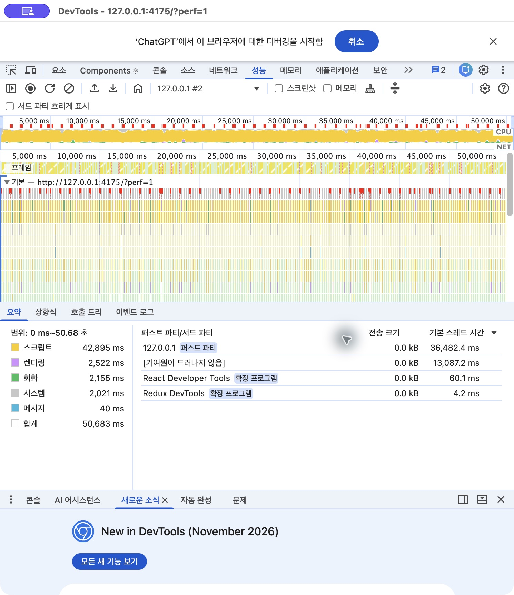

# 계단 장면의 Chrome 스레드 시간 비교 — 2026-11-06

성능 패널 비교와 지형 구역 분리 변경을 `ee5c477`로 커밋해 `origin/deploy_page`에 푸시했다. 이후 기존 지형 묶음과 구역 분리 빌드를 Chrome Performance에서 각각 녹화했다. 렌더링 코드는 이 조사에서 추가로 변경하지 않았다.

## 조건

- 계단 중간 `(-66.3, 18.8, 88.8)`, 같은 저장 상태와 기본 카메라, 게임 시각 13:08 정지, 그림자 켬, 패널·GPU 타이머 끔.
- 1440×900 캔버스, DPR 1, Chrome CPU 제한 없음, DevTools 스크린샷 수집 끔. 관리 탭에서는 DevTools 연결 후에도 실제 캔버스 크기를 확인했다. 연결할 때 1600×1000으로 변경됐던 예비 기록은 전후 표에서 제외했다.
- 실제 Chrome 창과, 이전 지연이 관측된 자동화 관리 탭을 따로 비교했다. 각 녹화의 시작 후 3~28초를 사용했다. 첫 실제 창 녹화에서 이후 창 전환으로 콜백이 중단된 구간은 제외했다. 두 환경의 값을 합산하지 않았다.
- 변경 전 `index-DULmuqzU.js`, 변경 후 `index-DpsNJoKU.js`. 지표는 추적된 동일 게임의 `FireAnimationFrame` 시작 사이 간격이며 화면에 표시 완료된 프레임의 간격과는 다르다.

## 결과

| 환경 · 지표 | 지형 구역 분리 전 | 지형 구역 분리 후 |
| --- | ---: | ---: |
| 실제 Chrome 창 FPS | 120.1 | 119.9 |
| 실제 Chrome 창 간격 p95 | 9.38ms | 9.31ms |
| 실제 Chrome 창 100ms 초과 (25초) | 0 | 0 |
| 관리 탭 FPS | 51.0 | 52.3 |
| 관리 탭 간격 p95 | 46.52ms | 42.97ms |
| 관리 탭 100ms 초과 (25초) | 24 | 21 |
| 관리 탭 최대 간격 | 275.91ms | 203.70ms |
| 관리 탭 콜백 평균 스레드 CPU | 7.50ms | 7.56ms |

관리 탭에서 p95와 초과 개수는 이번 한 쌍에서 낮아졌다. CPU 평균은 비슷했고 긴 지연은 남았다. 이전 계측에서는 100ms 초과 개수가 반대로 증가한 실행도 있어 안정적인 꼬리 지연 감소로 보지는 않는다.

## CPU 실행과 대기 구분

`dur`(경과)과 `tdur`(스레드 CPU)를 구분했다. 100ms 초과 간격에 걸친 최상위 `RunTask` 슬라이스의 CPU 하한/상한을 계산했다. 잘린 슬라이스는 밖에 놓일 수 있는 실행 시간을 고려하고, 추적되지 않은 구간은 상한에서 전부 CPU로 간주했다. 중첩 이벤트는 중복 합산하지 않는다. [Chromium의 스레드 시간 설명](https://www.chromium.org/developers/how-tos/trace-event-profiling-tool/trace-event-reading/) 참고.

- 변경 전 최장 275.91ms 간격: 직전 콜백 경과 **179.48ms**, 스레드 CPU **10.04ms**. 전체 간격의 메인 스레드 CPU 상한은 **16.71ms**였다.
- 변경 후 최장 203.70ms 간격: 직전 콜백 경과 **97.77ms**, 스레드 CPU **9.78ms**. 콜백 종료 후에도 105.93ms 뒤에 다음 콜백이 시작됐고, 전체 간격의 메인 스레드 CPU 상한은 **21.99ms**였다.
- 전후 45개 중 **44개**는 이 보수적인 CPU 상한이 간격의 절반 미만이었다. 나머지 한 사례는 일부 큰 작업이 간격 경계를 넘어 상한으로 구분할 수 없었다. 게임 코드가 메인 스레드에서 계속 계산하느라 시간을 다 쓴 상황은 대부분의 긴 간격을 설명하지 못한다.
- 이 추적은 메인 스레드가 실제 실행하지 않은 시간을 보여 주지만, 스레드가 브라우저/드라이버 내부에서 기다렸는지 OS에서 실행 기회를 받지 못했는지까지 구분하지 않는다. 다른 스레드의 작업, GPU 큐 및 화면 표시 대기도 포함해 가능한 원인이 남는다. 이전 [같은 프레임의 GPU 시간 기록](./panel-stall-2026-11-06.md)도 GPU 명령 실행만 측정했으므로 특정 드라이버 문제로 단정할 근거가 아니다.

[비교 JSON](./chrome-thread-comparison-2026-11-06.json)과 [재분석 스크립트](../../scripts/compare-frame-traces.py)를 제공한다. 원본 Chrome 트레이스는 다른 탭/확장 메타데이터가 포함될 수 있어 Git에 넣지 않고 `/private/tmp/wild-atlas-trace-{before,after}-2026-11-06.json.gz`, `/private/tmp/wild-atlas-managed-before-2026-11-06.json.gz`, `/private/tmp/wild-atlas-managed-1440-after-2026-11-06.json.gz`에 보관했다. Chrome Performance의 트레이스 로드에서 열 수 있다. 스크립트에 파일들을 전달하고 `--seconds 25`로 같은 범위를 재분석한다.

