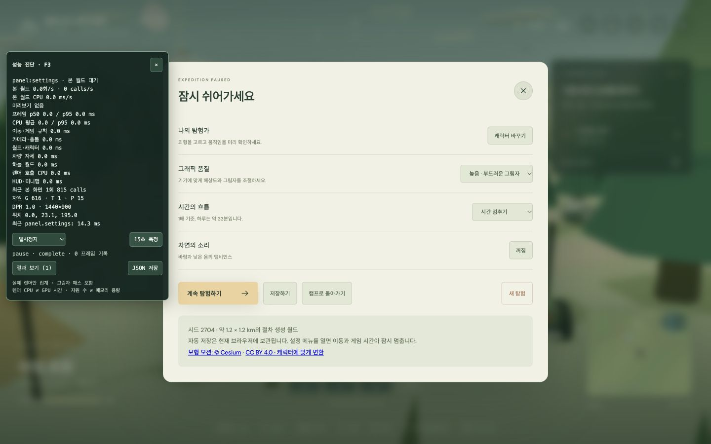
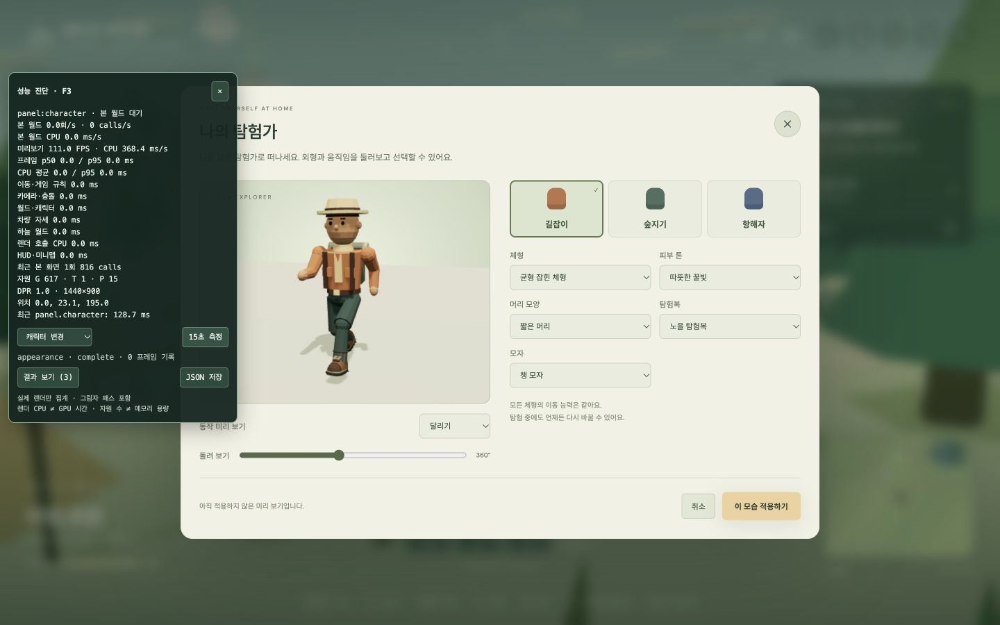

# 메뉴·캐릭터 미리보기의 본 월드 갱신 중단 — 2026-11-04

설정·지도·배낭·도움말·캐릭터 선택·시작 화면에서는 본 월드를 계속 갱신하지 않는다. 마지막으로 표시한 화면을 유지하고, 그래픽 품질·화면 크기·외형·차량 위치 등 실제 변경이 있을 때만 한 번 다시 그린다. 캐릭터 미리보기는 자신의 루프에서 계속 움직인다.

## 비교 결과

같은 계측 코드가 들어간 개선 전/후 production 빌드를 Chrome에서 조작했다. 각 구간은 3초 준비 후 약 15초다. 설정·지도는 정적으로 유지했고, 캐릭터 미리보기는 달리기를 선택했다. 본 월드 FPS를 0으로 만드는 것은 프레임 저하가 아니라 **불필요한 렌더 자체의 중단**이므로 초당 렌더 횟수와 CPU 경과 시간을 비교한다.

| 항목 | 개선 전 | 개선 후 |
| --- | ---: | ---: |
| 설정: 본 월드 렌더 / 초 | 49.25회 | **0회** |
| 설정: 본 월드 calls / 초 | 40,137 | **0** |
| 설정: 본 월드 CPU 경과 / 초 | 882.83ms | **0ms** |
| 지도: 본 월드 렌더 / 초 | 50.22회 | **0회** |
| 지도: 본 월드 calls / 초 | 40,925 | **0** |
| 지도: 본 월드 CPU 경과 / 초 | 876.70ms | **0ms** |
| 캐릭터: 뒤쪽 본 월드 렌더 / 초 | 46.11회 | **0회** |
| 캐릭터: 미리보기 렌더 / 초 | 46.11회 | **117.45회** |
| 캐릭터: 본 월드 + 미리보기 CPU 경과 / 초 | 883.50ms | **338.03ms** |

이 세션에서 미리보기의 실제 렌더 빈도는 약 **2.55배**, 두 renderer의 콜백 CPU 경과 합계/초는 약 **61.7% 감소**했다. 미리보기는 전후 모두 한 번에 271 calls이며, 자체 콜백 평균 시간도 2.85ms → 2.88ms로 비슷하다. 모델·동작·그림자 품질을 줄여서 얻은 수치가 아니다. 미리보기 FPS는 렌더 콜백 횟수이며 실제 디스플레이 표시·GPU 실행 시간을 따로 측정한 것은 아니다.

원본과 재계산 결과:

- [개선 전 JSON](./menu-before-2026-11-04.json): 설정·지도·미리보기 3건.
- [개선 후 JSON](./menu-after-2026-11-04.json): 같은 3건 + 변경 이벤트 검증 1건.
- [조건·빌드 SHA-256·비교 수치](./menu-comparison-2026-11-04.json).
- [이전 첫 플레이 계측](./browser-performance-2026-11-04.md)은 다른 렌더 DPR 조건이 섞여 있어 이번 정량 비교에 사용하지 않았다.

## 조건과 한계

- Apple M1 Pro / macOS arm64 / Chrome 156.0.0.0. viewport **1440×900**, drawing buffer **1440×900**, 실제 렌더 DPR **1.0**, 그림자 켬. viewport override를 페이지 로드 전에 적용해 두 빌드의 DPR을 맞췄다.
- 시드 2704, 기본 캐릭터·차량, 위치 `(0, 23.1069, 195)`, 카메라 초기 방향. 시작하기 전 설정에서 게임 시각을 09:40에 고정했다. 기능 회귀 조작은 세 가지 비교 측정이 끝난 뒤 수행했다.
- 개선 전 임시 빌드: `/private/tmp/wild-atlas-menu-before-20261104`, 앱 `index-DG03I71F.js`. 개선 후 앱 `index-dv2ZRLlC.js`. 해시는 비교 JSON에 있다. 원래 Git 기준은 `1d17f4a`이며 이전 턴의 패널 작업과 이번 계측 확장을 포함한 작업 트리 기준이다.
- 개선 전 `127.0.0.1:4174`, 개선 후 `127.0.0.1:4175`를 사용해 기존 저장과 분리했다. 같은 탭을 사용하고 이전 페이지를 `about:blank`로 종료한 뒤 다음 빌드로 전환했다. 측정 중 빌드·테스트를 병행하지 않았다.
- renderer activity는 실제 콜백에서만 누적한다. 독립된 500ms 진단 타이머가 스냅샷·15초 종료·결과 UI를 처리하며 **측정을 위해 본 월드 RAF를 유지하지 않는다.**
- `activity.*.cpuMsPerSecond`는 콜백에 진입해서 나올 때까지의 경과 시간을 실제 벽시계 초로 나눈 값이다. 프로세스 CPU 사용률, GPU 시간, 전력·배터리 절감률이 아니다. 진단 패널 자체·브라우저 layout/paint·GPU 작업은 합계에 포함하지 않는다.
- 전후 모두 같은 카운터·타이머·미리보기 렌더 통계를 사용했다. 작업 큐 지연 때문에 실제 기록 시간은 약 15.00~15.04초이며, 비율은 실제 경과 시간으로 정규화했다. RAF timestamp 기반 프레임 샘플 수와 누적 카운터의 경계가 한두 프레임 다를 수 있다. 표는 `activity` 카운터를 사용한다.
- 개선 후 정적 구간에는 본 월드 프레임 샘플이 없으므로 `fps=0`, `position=null`, CPU 백분위 0이 기록될 수 있다. 화면의 실제 위치는 별도 진단 context로 표시한다. 이를 0 FPS 게임이나 측정 실패로 해석하지 않는다.
- 단일 기기·순차 측정이다. 브라우저·발열·다른 프로세스는 완전히 통제하지 않았고, 이 수치를 모든 기기의 보장 성능으로 사용하지 않는다. 플레이 중 월드 렌더·카메라 충돌 비용은 이번 최적화 대상이 아니므로 별도로 남아 있다.

## 구현

[FrameLoop](../../src/game/app/frame-loop.ts)는 다음 정책을 소유한다.

| 모드 | 예약 정책 | 복귀 시 시간 |
| --- | --- | --- |
| play | 최대 1개의 RAF를 예약하며 연속 실행 | 첫 dt=0, 이후 기존 최대 45ms 제한 유지 |
| idle | 변경이 있을 때만 RAF 1개, 처리 후 종료 | 시뮬레이션 dt=0 |
| blocked | 예약 취소, 변경 표시를 보관 | visible/context 복구 후 필요한 갱신 재개 |

[Game](../../src/game/app/game.ts)은 메뉴 전환 때 입력·실행 모드를 동기화한다. 일반적인 메뉴 열기는 마지막 포즈·카메라·빛·파티클을 그대로 유지한다. 품질·resize·WebGL 복구는 렌더만 요청하고, 외형 적용·차량 회수·캠프 복귀처럼 상태가 바뀌면 뷰 동기화도 요청한다. HUD의 주기 갱신도 플레이에서만 실행하며 메뉴 변경·resize 등에는 필요한 UI를 한 번 갱신한다.

메뉴 전후에는 시계를 초기화해 멈춘 시간을 이동·중력·차량·애니메이션 계산에 더하지 않는다. 기존 이동의 내부 substep과 활성 플레이 로직은 유지했다. 숨김 탭과 context loss는 blocked 정책으로 처리한다.

[CharacterPreview](../../src/game/ui/character-preview.ts)도 별도의 FrameLoop를 사용한다. 미리보기 동작·외형·회전은 유지하고, hidden/context loss에서 중단, 복귀 시 dt 초기화, 닫힐 때 RAF·listener·observer·renderer 해제를 수행한다. 현재 미리보기에는 별도 30 FPS 제한을 걸지 않았다.

[RenderActivity](../../src/game/diagnostics/render-activity.ts)는 world/preview를 분리한다. 패널은 JSON schema 2를 사용하며, 기존 실제 본 월드 프레임 통계와 새 `activity` 누적 카운터를 함께 보관한다. 패널을 끄면 진단 타이머와 계측을 중단한다.

## 검증

- **설정·지도·미리보기 유지:** 각각 15초 동안 본 월드 프레임·calls·카메라·월드·렌더 CPU 누적이 모두 0이었다. 미리보기는 1762회 렌더됐다.
- **품질·resize:** 추가 기록 `mixed`에서 품질 low→high, viewport 1280×800→1440×900을 수행했다. 정확히 **4프레임**만 렌더됐으며 simulation/camera/world/vehicle/sky/HUD 구간 누적은 모두 0이었다. 변경 후 지속적인 RAF가 남지 않았다.
- **변경 비용:** 위 4프레임 렌더 경과 합계는 482ms였다. 품질·resize 변경의 일회성 렌더 지연은 남아 있다. 기존 품질 설정의 `material.needsUpdate` 처리는 유지했으며, 재컴파일 등 개별 원인의 기여는 이번 측정에서 분리하지 않았다.
- **외형 적용:** 의상을 숲길로 적용했다가 노을로 복원하고, 본 월드에 복귀하는 동작을 확인했다. 미리보기의 계단 오르기·내려가기·점프 동작 선택도 확인했다.
- **정지 중 입력:** 보행 중 설정을 연 뒤 W를 2초 눌러도 `(-0.4, 23.0, 189.1)` 위치가 유지됐다.
- **공중 정지·복귀:** 점프 중 `(-0.6, 25.2, 184.8)`에서 메뉴를 열고 W를 1.6초 눌러도 위치가 유지됐다. 닫고 W로 이동한 뒤 `(-1.0, 23.0, 178.2)`에 착지·보행으로 이어졌다. 정지 시간을 한꺼번에 진행하지 않았다.
- **나머지 UI:** 배낭·도움말을 열고 닫고, 메뉴 안에서 F3를 끄고 다시 켜는 동작을 확인했다. 비교 후 시각 흐름을 1배로, viewport override를 기본값으로 복원했다. 해당 검증 탭의 console error는 0건이었다.
- **단위 테스트:** 20개 파일 **331개 테스트 통과**. 추가 검증은 연속/단발 예약, 여러 변경 병합, 60초 정지 후 dt=0, blocked 중 변경 보존, 프레임 안에서 메뉴 열기, dispose 뒤 콜백 방지, world/preview 분리 집계와 실제 벽시계 정규화를 다룬다.
- `bun run check`, `bun run build`, `git diff --check` 통과. 기존 Three.js vendor 500kB 경고는 남는다. 실제 context 강제 손실과 운영체제 탭 숨김 경로는 브라우저에서 강제 주입하지 않았으며 blocked 단위 검증과 이벤트 연결로 확인했다.





사진의 패널 수치는 최근 약 5초 구간이며 위 표의 약 15초 평균과 다를 수 있다.

## 재현

```sh
bun run build
bun run preview --port 4175
# http://127.0.0.1:4175/?perf=1
```

F3 또는 `?perf=1`로 패널을 열고, 설정·지도·캐릭터 미리보기에서 각각 15초 측정한다. 본 월드 대기 구간의 `activity.world.frames/calls/cpuMs`가 0인지 확인한다. 미리보기는 `activity.preview`로 별도 비교한다. 메뉴에서 품질이나 화면 크기를 바꾸면 필요한 프레임이 발생하는 것이 정상이다.

구현의 브라우저 동작 근거는 [MDN requestAnimationFrame](https://developer.mozilla.org/en-US/docs/Web/API/Window/requestAnimationFrame)과 [Page Visibility API](https://developer.mozilla.org/en-US/docs/Web/API/Page_Visibility_API)를 참고했다. 다음 성능 작업은 활성 플레이의 카메라 충돌 후보 축소다.
