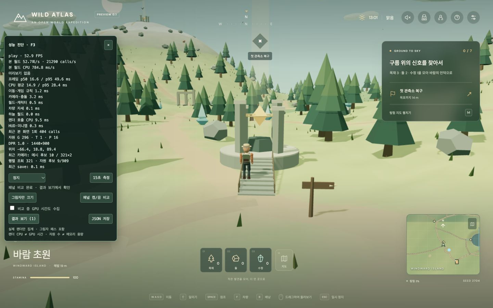

# 성능 패널 켬/끔 비교와 긴 렌더 프레임 — 2026-11-06

먼저 기존 성능 진단·카메라·렌더링 변경을 `a998bbe`로 커밋하여 `origin/deploy_page`에 푸시했다. 아래 비교 기능과 지형 변경은 후속 로컬 작업이다.

## 패널 표시가 원인인지 확인

같은 Chrome 탭에서 그림자 켬, 1440×900 drawing buffer, DPR 1, 같은 계단 중간 위치·카메라·정지한 게임 시각을 유지했다. 패널 켬 → 끔 → 끔 → 켬 순서로 각 3초 준비, 15초 기록했다. 패널을 끈 동안 기존 패널의 집계·타이머·DOM·LoAF observer는 꺼진다. 두 조건에만 공통으로 작은 기록기를 사용한다. 이는 기존 RAF의 타임스탬프와 실제 callback 진입/종료, 렌더 호출 진입/종료를 고정 크기 배열에 저장한다. 비교 중에 별도 RAF를 만들지 않는다. 위치·시점·해상도·시각이 달라지거나 탭을 숨기면 비교를 중단한다. 카메라 수치의 무의미한 보간 오차만 허용한다.

최초 완료한 [GPU 타이머 없는 비교 원본](./panel-ab-before-2026-11-06.json)은 다음과 같다.

| 상태 | FPS (2회 평균) | 프레임 p95 (2회 평균) | RAF 간격 >100ms (30초 합계) |
| --- | ---: | ---: | ---: |
| 패널 켬 | 81.8 | 25.0ms | 2 |
| 패널 끔 | 79.6 | 24.9ms | 7 |

이 기록에서 패널 타이머 갱신 최대는 11ms였다. 패널을 끈 경우에도 직전 렌더 호출 141.8ms를 포함한 약 150.1ms 간격이 있었다. 패널을 끄면 반드시 지연이 줄어드는 패턴은 확인되지 않았다. 2회의 결과로 패널을 켜면 오히려 빨라진다는 결론도 내릴 수 없다.

## 긴 프레임에서 분리한 구간

느린 **다음 프레임의 간격**과 **직전 callback 내부 경과**를 구분한다. 긴 간격을 다음 프레임에서 실제로 실행한 코드 비용으로 합산하지 않는다. 기록기는 직전 callback의 렌더 호출 경과 및 종료 이후 대기, Chrome의 LoAF·Long Task를 같은 시계로 기록한다. LoAF 개수와 >100ms RAF 간격 개수는 서로 다른 지표다.

추가 진단은 WebGL2의 `EXT_disjoint_timer_query_webgl2`를 사용했다. 렌더 8회 중 1회만 샘플링하고 같은 프레임의 CPU 측 경과와 GPU 명령 시간을 연결했다. 결과가 준비되지 않았으면 기다리지 않으며, disjoint 측정은 버리고 비교 종료 시 query를 해제한다. GPU 샘플은 명령 실행 구간이고, GPU 큐 진입 대기·브라우저 합성·화면 표시 시간을 모두 포함하지 않는다.

- 변경 전 한 샘플: 직전 렌더 호출 경과 **186.6ms**, 같은 프레임 GPU **2.37ms**, callback 전체 242.4ms.
- 변경 후에도 한 샘플에서 렌더 호출 **177.4ms**, GPU **2.80ms**였다. 즉, 이 사례에서 GPU가 계산한 시간만으로 긴 간격을 설명할 수 없다. 렌더 호출 내부의 CPU 작업·브라우저/드라이버 대기·스레드 스케줄링 중 어느 것이 지연을 만들었는지까지는 이번 표본으로 구분할 수 없다.

이전의 별도 Chrome 추적은 다른 녹화 조건에서 GC·레이아웃이 짧았고 100ms 지연이 재현되지 않았다. 이번에도 그 기록을 현재 지연의 원인 배제 근거로 사용하지 않았다. GPU 타이머는 상세 진단 옵션이며 기본 비교에서는 끈다. 두 종류의 실행은 계측 부하와 시스템 상태가 다를 수 있어 평균 FPS를 직접 비교하지 않는다.

## 불필요한 지형·풀 렌더링 제거

기존에는 지형 전체 135,200개 삼각형과 풀 전체 인스턴스가 큰 경계 하나씩을 사용했다. 경계의 일부만 화면에 들어와도 묶음 전체를 renderer에 넘겼다. 지형은 65×65 구간, 풀은 같은 310m 타일로 나눠 화면 밖 묶음을 제외한다. 지형의 정점·색·법선·삼각형 방향과 풀의 위치·색·크기 분포를 유지했다. 재질과 풀 geometry는 공유하며, 원래 게임의 해상도·그림자·카메라·충돌 규칙을 사용한다. 지형을 나누면서 호출 수가 소폭 늘어나는 대신 제출하는 삼각형 수를 줄인다.

`audit:game`의 전체 선언 삼각형 인스턴스 270,816과 인스턴스 슬롯 7,359는 그대로였다. 지형 타일의 16비트 인덱스 사용으로 선언 CPU 버퍼는 약 8.00→7.26MB였다. 이 수치는 화면 제출 삼각형 수나 GPU 메모리 사용량과 다르다.

GPU 샘플을 수집한 동일 조건 4×15초 비교:

| 항목 | 구역 분리 전 | 구역 분리 후 |
| --- | ---: | ---: |
| 제출 삼각형/프레임 | 307,181 | 241,725 (−21.3%) |
| 렌더 호출/프레임 | 387 | 402 |
| 렌더 호출 경과 평균 | 11.21ms | 11.11ms |
| FPS (회차 평균) | 49.1 | 49.8 |
| 프레임 p95 (회차 평균) | 56.25ms | 52.05ms |
| RAF 간격 >100ms (60초 합계) | 67 | 54 |

원본: [변경 전](./render-stall-before-2026-11-06.json), [변경 후](./render-stall-after-2026-11-06.json). 화면에 넘기는 삼각형 수 감소는 확인했다. 상세 샘플링 결과의 긴 간격은 줄었지만 표본이 작고 시스템 부하를 통제하지 않아 지연의 근본 원인이 제거됐다고 해석하지 않는다.

GPU 타이머를 끈 별도 전후 비교에서도 위치 `(-66.414, 18.750, 89.403)`, 시각 13:01, 해상도·시점·그림자를 같게 유지했다. 모두 4×15초이고 각 행은 회차 평균 또는 명시한 합계다.

| 항목 | 구역 분리 전 | 구역 분리 후 |
| --- | ---: | ---: |
| 제출 삼각형/프레임 | 307,182 | 241,726 |
| FPS | 53.51 | 54.80 |
| 렌더 호출 경과 평균 | 10.25ms | 9.80ms |
| 프레임 p95 | 43.38ms | 41.77ms |
| 프레임 p99 | 90.48ms | 110.45ms |
| RAF 간격 >100ms (60초 합계) | 27 | 38 |

원본: [변경 전](./terrain-ab-before-2026-11-06.json), [변경 후](./terrain-ab-after-2026-11-06.json). 최종판의 패널 켬/끔 FPS는 54.54/55.06, >100ms 간격은 각각 21/17개였다. 일반 비교에서는 긴 프레임이 줄지 않았다. 두 측정 방식에서 공통으로 확인된 것은 삼각형 약 21% 감소이며, 끊김 완화에 대해서는 일관된 효과가 없었다.

같은 장면에서 RAF 제출 속도를 약 60 FPS로 제한하는 실험도 했다. 최종판의 제한 없는 비교(54.8 FPS, p95 41.77ms, >100ms 38개)와 비교해 제한 실험은 **43.6 FPS, p95 51.08ms, >100ms 42개**였다. 이 방식은 적용하지 않았다. [실험 원본](./pacing-experiment-2026-11-06.json).

## 재현과 검증

- 로컬에서 `bun run build`, `bun run preview --port 4175 --strictPort`. 같은 저장 위치·시점·해상도를 유지한다. 설정에서 **시간 멈추기**를 고른 다음 플레이 화면의 F3 → **패널 켬/끔 비교**를 선택한다. 플레이어를 움직이지 않는다. 결과 JSON에는 네 구간이 기록된다. GPU 실행 시간은 **비교 중 GPU 시간도 수집**을 선택했을 때만 측정한다.
- `bun run check`, `bun run build`, 26개 파일의 348개 테스트. 새 테스트는 직전 callback 귀속, GPU query의 비동기 결과·수명, 지형 타일 경계의 기존 삼각형·속성 일치를 검증한다.
- 실제 Chrome에서 최종 번들 `index-DpsNJoKU.js`로 계단 상하 이동을 확인했다. 브라우저 오류는 없었고, 검증 후 원래 viewport와 시간 흐름을 복구했다.
- [Chrome LoAF 공식 설명](https://developer.chrome.com/docs/web-platform/long-animation-frames), [Khronos WebGL2 GPU 타이머 명세](https://registry.khronos.org/webgl/extensions/EXT_disjoint_timer_query_webgl2/).
