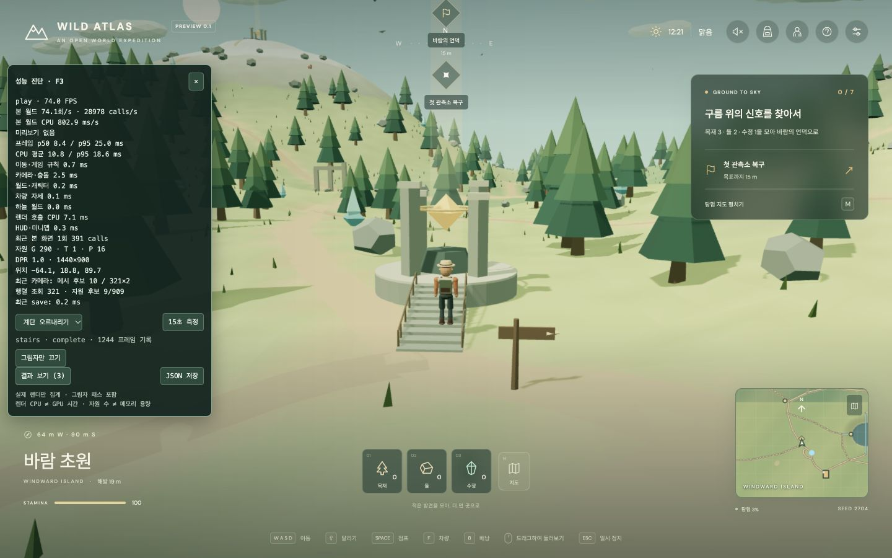

# 그림자·렌더 호출·긴 프레임 확인 — 2026-11-04

그림자 비용 분리 → 고정 부품의 렌더 호출 감소 → 100ms 이상 프레임 추적 순서로 확인했다. 렌더링의 반복 작업은 줄었지만 긴 프레임을 완전히 해결한 상태는 아니다. 과거의 단일 측정 35.0→33.1 FPS와 이번 측정을 직접 이어 붙이지 않는다.

## 1. 해상도를 고정하고 그림자만 비교

기존 높음/가벼움 설정은 DPR과 그림자를 함께 바꿨다. F3 개발 패널에 **그림자만 끄기/켜기**를 추가했다. 그림자 전환은 품질 설정과 같은 material 재컴파일을 유발할 수 있으므로 3초 준비 후 15초 기록한다. 기록 중에는 전환을 잠근다. 일반 품질 설정은 기존처럼 DPR도 바꾼다.

Chrome 156, 1440×900 drawing buffer, DPR 1, 12:21 시간 정지, 같은 계단 중간 위치와 시점에서 on/off를 세 번 번갈아 확인했다. 호출 수는 그림자 켬 약 603~606, 끔 약 355~361이었다. 그림자 패스가 약 245개 호출을 더 발생시킨다. 그림자 map은 2048², 매 프레임 갱신을 유지했다.

탐색 측정 중 일부 빌드·테스트가 겹쳤고 FPS 편차가 컸다. 이 여섯 기록으로 일정한 FPS 배율을 주장하지 않는다. [전체 원본](./shadow-before-2026-11-04.json)의 첫 여섯 report에 보관했다. 이후 전후 비교는 빌드·테스트 없이 별도로 세 번씩 진행했다.

## 2. 고정 부품 병합과 작은 그림자 정리

- 도로·다리의 고정 기둥/보강재, 관측소 바닥·계단·기둥, 하늘 다리 판자를 같은 material과 렌더 속성끼리 병합한다. 월드 부품은 32m 구획으로 나눠 먼 부분의 culling을 유지한다. 하늘 판자는 공통 material을 사용한다.
- 신발 끈·금속 고리·박음질·작은 밑창 돌기를 신발 내부에서 병합하고 castShadow를 끈다. 가죽·밑창·발목 칼라와 움직이는 관절은 유지한다. 신발 표면의 삼각형·외형은 그대로다.
- 지면에 붙은 도로, 가는 다리 줄/보강재, 반투명 상승장 효과의 그림자를 제외한다. 다리 바닥·주요 기둥, 계단, 캐릭터 몸체와 신발 본체의 그림자는 남긴다.
- 병합은 월드와 캐릭터 생성 시 한 번 수행한다. 위치·법선·삼각형을 root 좌표로 옮기고, 사용하지 않는 원본 geometry와 임시 복사본을 해제한다. 살아 있는 공유 geometry는 해제하지 않는다. 움직이는 상승기·룬·풍차·캐릭터 관절은 병합 대상에서 제외한다.
- 카메라 충돌 index는 최종 geometry로 구성한다. 시야 거리·해상도·지형 해상도·게임 이동 규칙은 줄이지 않았다.

### 같은 계단 위치에서 15초 × 3회씩

| 항목 | 변경 전 | 렌더 최적화 후 |
|---|---:|---:|
| FPS, 회차 평균 | 56.5 | 80.7 |
| 회차별 FPS 범위 | 55.1~58.7 | 78.4~82.9 |
| 렌더 호출/프레임 | 600.7 | 389.6 (−35.1%) |
| 렌더 호출 CPU 경과/프레임 | 10.37ms | 6.76ms (−34.8%) |
| 프레임 p95, 회차 평균 | 41.63ms | 25.07ms |
| 프레임 p99, 회차 평균 | 100.07ms | 69.90ms |
| 브라우저 LoAF >100ms, 각 45초 합계 | 22개 | 9개 |

이는 **계단 중간 정지 장면**의 비교다. 계단을 계속 오르내리는 평균 FPS가 아니다. 각 회차 통계의 산술 평균이며 합쳐진 표본의 percentile이 아니다. JSON으로 플레이어의 시작/끝 위치와 안정된 카메라 위치·quaternion이 모두 같은 것을 확인했다. 배경 구름·새·여우는 계속 움직여 calls가 조금 변한다. CPU 경과에는 드라이버 대기가 포함될 수 있으며 GPU 시간 또는 CPU 사용률이 아니다.

전: `index-Cx-OnP6q.js`의 report 7~9. 후: `index-jqSeQg-7.js`의 report 1~3. 원본은 [전](./shadow-before-2026-11-04.json), [후](./shadow-render-after-2026-11-04.json), [수치와 동일 조건 검사](./shadow-comparison-2026-11-04.json)에 있다. 후의 mixed report는 실제 조작 확인용이며 표에서 제외했다.

전체 씬의 선언 수는 mesh 1,279→715, material 433→230, castShadow mesh 1,181→576이다. 전체 삼각형 인스턴스 수 270,816은 유지했다. 이는 숨은 오브젝트를 포함한 headless 씬 수이며 실제 draw calls나 VRAM 용량이 아니다. 전체 material/geometry 공유와 자원 소유권 통합은 여전히 후속 작업이다.

## 3. 100ms 이상 지연의 추적 결과

### 같은 측정의 브라우저 LoAF

성능 패널을 켰을 때만 `PerformanceObserver`로 `long-animation-frame`을 수집한다. 캡처마다 >100ms 항목 최대 200개, 느린 main callback의 구간별 시간, 브라우저 callback 출처와 강제 style/layout 시간을 JSON에 보관한다. 닫거나 dispose하면 observer를 중단한다. 브라우저 Window/DOM 참조는 보관하지 않는다. API 미지원 여부도 환경 정보에 기록한다.

전후 표의 긴 프레임에서 script attribution의 강제 style/layout은 모두 0ms였다. 렌더링 이후의 style/layout~프레임 끝 구간에는 paint와 대기도 포함되므로 그 값 전체를 layout 비용으로 해석하지 않는다. shader program 수는 각 캡처 안에서 고정이었다. 이 사실만으로 GC 또는 GPU 대기를 배제할 수 없다.

최적화 후 남은 9개 LoAF 중 7개에 패널의 500ms 통계 timer도 함께 나타났다. 패널은 표시하지 않는 자원 범위·카메라 분포까지 저장용 전체 요약으로 계산하고 있었다. 실시간 요약은 프레임/CPU 분포 두 개와 구간 평균만 계산하도록 바꿨다. 저장 시의 전체 통계는 유지했다. 전체 통계와 표시 값이 같은지 별도 회귀 테스트를 추가했다. timer의 브라우저 경과 시간 전체가 순수 계산 비용이라는 뜻은 아니다.

이 후속 변경의 [최종 smoke 원본](./shadow-after-2026-11-04.json)은 가까운 다른 계단 위치에서 63.0 FPS, 387.7 calls, 렌더 CPU 8.65ms, LoAF >100ms 8개였다. 원래 비교와 위치·실행 시점이 달라 A/B 표에 섞지 않는다. FPS와 긴 프레임에는 환경 편차가 남아 있으며, 통계 계산 축소로 지연을 없앴다고 주장하지 않는다.

### 별도의 Chrome DevTools Performance 기록

실제 Chrome 창에서 Performance 녹화를 실행하고 파일로 저장했다. [오프라인 분석](./chrome-trace-analysis-2026-11-04.json), [분석 스크립트](../../scripts/analyze-browser-trace.py)를 제공한다. 원본은 로컬 `artifacts/chrome-stairs-2026-11-04.json.gz`에 보관한다. 전체 트레이스와 Chrome 창 캡처에는 게임 외의 탭·확장 프로그램 메타데이터가 포함되어 Git에서 제외했다. 프레임워크 UI를 통한 자동화 탭의 측정과 구별하기 위해 별도 로컬 탭을 사용했다. 녹화는 약 34.57초, 계단 상부 정지, 화면 해상도/DPR이 다르고 F3 패널은 닫힌 상태, CPU 제한 없음, 스크린샷 수집 없음이었다. 녹화한 탭은 종료했다.

- main RunTask 최대 96.62ms, animation callback 최대 93.07ms로 >100ms 지연이 재현되지 않았다.
- main thread MinorGC 408회, 최대 0.60ms; MajorGC 4회, 최대 5.44ms였다. 이 기록에서는 100ms 지연을 설명하는 GC 정지가 없었다.
- Layout 최대 0.91ms, UpdateLayoutTree 최대 0.50ms였다.
- 해당 renderer에 연결된 GPUTask 최대 3.36ms였다. 이는 trace의 task 경과 시간으로, 화면 한 프레임의 GPU 실행 시간이나 GPU 큐 대기 전체가 아니다. shader compile 이름의 이벤트는 없었지만, 해당 범주의 수집 한계 때문에 컴파일이 전혀 없었다는 보장은 아니다.

따라서 렌더 호출과 평균 비용의 감소는 확인했지만, 자동화 탭에서 관측된 모든 긴 프레임의 GC/스케줄링/GPU 원인을 확정하지 못했다. 다음 분석에서는 같은 탭·해상도·위치에서 F3 켬/끔을 교차하고, 지연이 재현되는 순간의 DevTools 기록을 비교해야 한다. 고정 FPS 보장이나 끊김 해결 완료로 해석하지 않는다.

## 검증과 재현

- `bun run check`, `bun run build`, 23개 파일 **343개 테스트** 통과. 기존 vendor chunk 500kB 경고는 남는다.
- 삼각형 병합 전후의 약 600개 시선에서 거리/occlusion 일치, 변환된 부모·공유 geometry·cell별 분리·렌더 속성 분리를 새로 검증했다. 기존 실제 월드 camera 시선·상승/하강·계단·벽·모션 테스트도 통과했다.
- Chrome에서 계단 중간→상부→방향 전환→하강→지면, 측면 회전, 정지 후 이동과 지면에서 점프→착지→달리기→방향 변경을 직접 조작했다. 확인한 시점에서 계단 틈이나 새 관통을 발견하지 못했다. 모든 시점의 부재를 보장하는 것은 아니다.
- 최종 번들 `index-hz6ETSqt.js`를 다시 불러와 계단 장면을 확인했다. 최종 smoke 이후의 추가 변경은 일반 품질 설정과 진단 그림자 버튼의 표시 동기화다. 시간 흐름과 viewport override는 확인 후 원래 설정으로 돌렸다. [최종 화면](./artifacts/shadow-final-build.png)의 순간 통계는 15초 비교표가 아니다.
- 재현: `bun run build`, `bun run preview --port 4175 --strictPort`, `http://127.0.0.1:4175/?perf=1`. F3 패널에서 계단 시나리오를 고르고 각 15초 측정 전 3초 준비 시간을 둔다. 같은 세이브·카메라·해상도에서 반복하고 CPU를 쓰는 빌드/테스트를 동시에 돌리지 않는다.
- trace 분석: `python3 scripts/analyze-browser-trace.py docs/architecture/artifacts/chrome-stairs-2026-11-04.json.gz`.

[Chrome LoAF 공식 설명](https://developer.chrome.com/docs/web-platform/long-animation-frames), [Three.js LightShadow](https://threejs.org/docs/pages/LightShadow.html)을 참고했다. 이번 변경은 로컬 소스와 미리보기에 반영했으며 커밋·푸시·배포는 수행하지 않았다.
